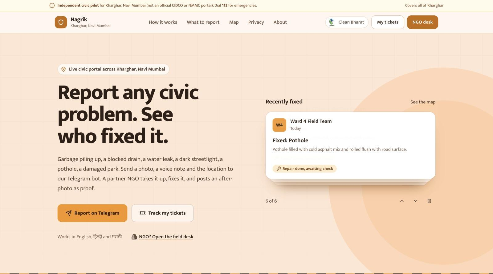
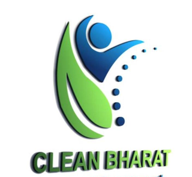
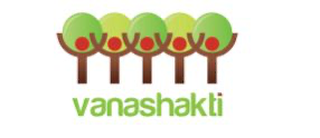
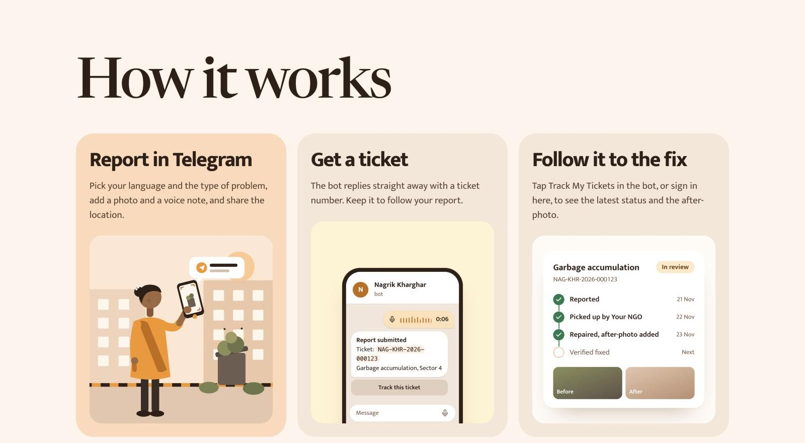
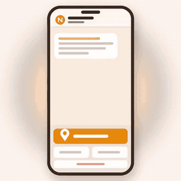
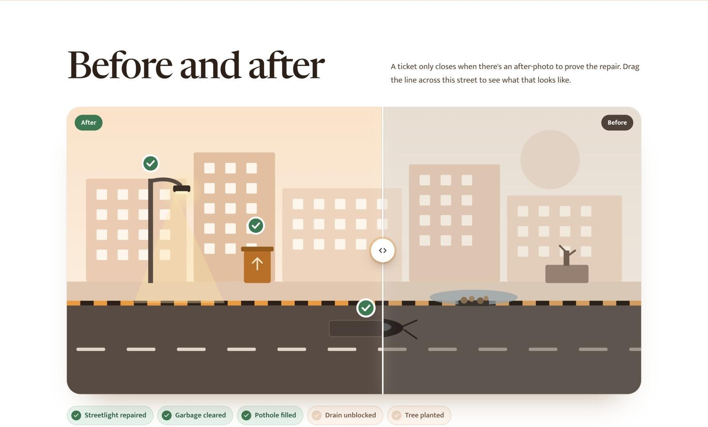
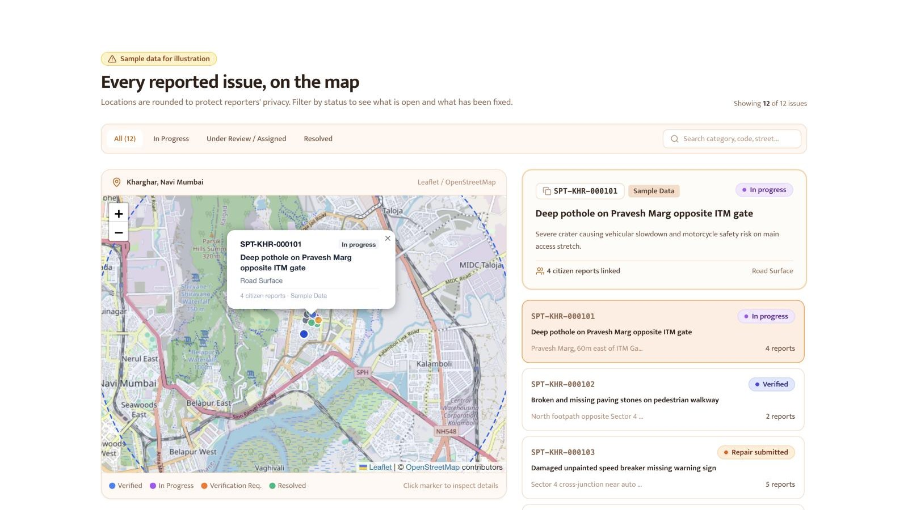
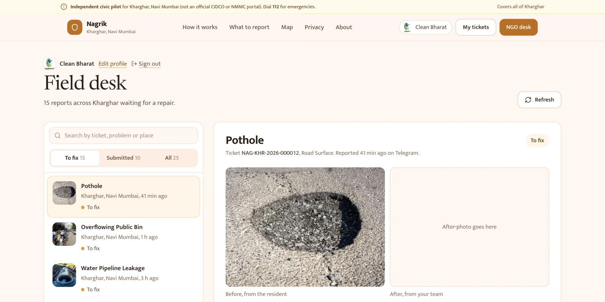
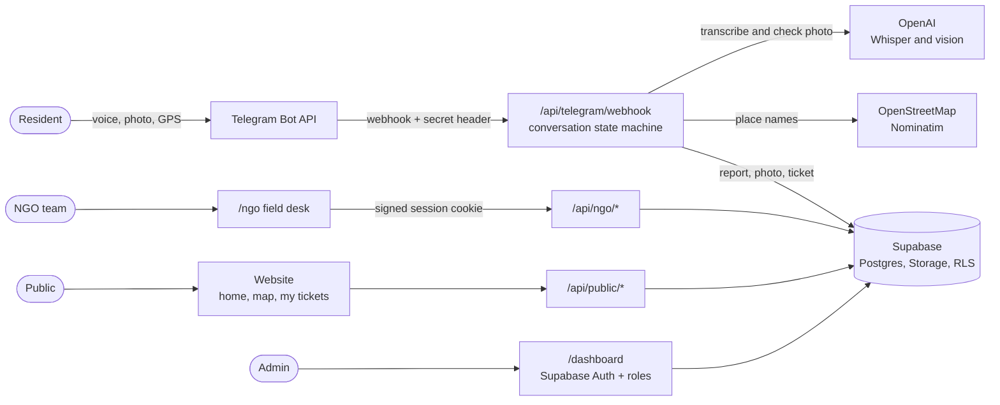
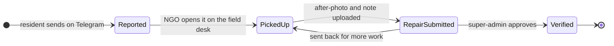

<div align="center">

# Nagrik · नागरिक · TP3TK8

**Report any civic problem in your city. See who fixed it.**

A civic accountability platform for India: a Telegram bot residents already know how to use,<br>
a field desk for the NGOs who do the repairs, and a public website that shows the proof.

[**Report on Telegram**](https://t.me/NagrikKhargharBot) · [How it works](#how-it-works) · [Run it locally](#run-it-locally) · [Deploy](#deploy-to-vercel)

<br>



</div>

<br>

## Why Nagrik exists

Every Indian city has the same story. A resident walks past an overflowing bin, a dark streetlight, or a pothole every morning. Everyone sees it, but nobody reports it, because reporting means forms, logins and office visits. People who do report rarely hear back.

Potholes alone killed **2,385 people in India in 2024**, up from 1,555 in 2020 ([MoRTH data tabled in Parliament](https://www.outlookindia.com/national/pothole-deaths-in-india-rise-53-in-5-years-9438-killed-between-2020-2024)). Most of those potholes had been seen, and many by the same people every day.

Nagrik fixes the two broken steps: **reporting has to take seconds**, and **the resident has to see the repair**.

It is built so any Indian city, ward or campus can run it: set the coverage area, invite local NGOs, and residents report in their own language from the phone they already have.

<br>

## Our NGO partners

<table>
  <tr>
    <td width="200" align="center"></td>
    <td>
      <b>Clean Bharat</b> is Nagrik's first NGO partner, working with us in our pilot area of <b>Kharghar, Navi Mumbai</b>.
      <br><br>
      Their field team picks up residents' reports on the Nagrik field desk, fixes the problem, and posts the after-photo as proof. Every fix they post carries their name and logo on the public site, so residents can see exactly who showed up.
    </td>
  </tr>
  <tr>
    <td width="200" align="center"></td>
    <td>
      <b>Vanashakti</b>, the Mumbai environmental NGO, is joining as our next partner. The partnership is being finalised.
      <br><br>
      Once confirmed, their team will pick up and resolve reports on the Nagrik field desk, with their name and logo on every fix.
    </td>
  </tr>
</table>

<br>

## How it works



| | Who | What happens |
|:-:|---|---|
| **1** | Resident | Opens the Telegram bot, taps the problem, records a voice note, sends a photo and their live location. About 30 seconds. |
| **2** | Nagrik | Transcribes the voice note word for word, checks the photo matches the problem, works out the local ward and police station, and issues a ticket number. |
| **3** | Partner NGO | Sees the report on the field desk, fixes it, and uploads an after-photo with a note (typed or spoken). |
| **4** | Resident | Opens *Track my tickets* and sees the before and after side by side. |

<br>

## The bot, step by step

Every step that needs the phone shows a short looping animation, so first-time users know exactly what to tap. The bot speaks **English, हिन्दी and मराठी**.

<table>
  <tr>
    <td align="center" width="33%"></td>
    <td align="center" width="33%"></td>
    <td align="center" width="33%"></td>
  </tr>
  <tr>
    <td align="center"><b>Describe it</b><br><sub>Hold 🎤, speak, let go</sub></td>
    <td align="center"><b>Show it</b><br><sub>📎 → Camera → send</sub></td>
    <td align="center"><b>Pin it</b><br><sub>📍 Send my location → confirm</sub></td>
  </tr>
</table>

<sub>Full-quality loops: <a href="public/telegram/how-to-voice.mp4">voice</a> · <a href="public/telegram/how-to-photo.mp4">photo</a> · <a href="public/telegram/how-to-location.mp4">location</a></sub>

<details>
<summary><b>What the resident sees after sending</b></summary>

```text
✅ Report Submitted Successfully!

Your Ticket Reference: NAG-2026-000011

📍 Location: MG Road, near City Market (GPS ±12 m)
🗺️ View on map

🏛️ Administrative Ward: Ward 12 (Central)
👮 Jurisdictional Police: City Police Station
📞 Station Desk: 022-27740100 | 🚨 Emergency: 112
```

</details>

<br>

## Proof, not promises

A ticket only closes when there is an after-photo. The home page lets anyone drag across a street to see what that looks like.



<br>

## Every issue, on one map

Reports appear on a public map with **locations rounded to about 30 m**, so nobody's home can be pinpointed from a complaint.



<br>

## The NGO field desk

A work queue built for people fixing things on the ground: what's waiting, the resident's photo and words, the exact pin, the ward and police contacts, and one form to submit the repair with an after-photo and a voice note.



<br>

## Features

<table>
<tr>
<td width="50%" valign="top">

**For residents**
- Report in ~30 seconds on Telegram, no app to install
- Voice notes transcribed **word for word**, no AI summary
- Photo checked against the chosen problem
- Live GPS location, or a typed landmark placed on the map
- Ticket number, ward and police contact immediately
- Track tickets in the bot or on the website

</td>
<td width="50%" valign="top">

**For NGOs**
- Password-protected field desk
- Queue of open reports, with search and filters
- Before photo, exact pin, ward and police station
- Submit repairs with an after-photo and a spoken note
- Your logo on every fix you post

</td>
</tr>
<tr>
<td valign="top">

**For everyone**
- Public map with privacy-rounded locations
- "Recently fixed" stack showing who fixed what
- 3 problem groups, 12 categories, and an "Other" option
- Hindi, Marathi and English throughout

</td>
<td valign="top">

**For administrators**
- Supabase-authenticated admin dashboard
- Reports and physical spots kept separate; humans decide merges
- Only a super-admin can mark an issue resolved
- Optional AI check of before/after photos (advisory only)

</td>
</tr>
</table>

<br>

## Architecture



**One Next.js app** serves the website and every API on Vercel. **Supabase** holds the data and photos; Telegram is the only input channel for residents.

### Life of a report



An NGO can **submit** a repair, but only a super-admin can **close** it. The NGO endpoints refuse to close or reopen an issue, and a database trigger blocks it for every signed-in user except a super-admin.

<br>

## Privacy and security

| Area | What Nagrik does |
|---|---|
| **Resident identity** | Telegram IDs are stored only as salted HMAC hashes; chat IDs are encrypted (AES-256-GCM). |
| **Accounts** | Each name belongs to one Telegram account, so it can't be claimed by anyone else. Passwords use **scrypt**, need 6+ characters, and the bot deletes the password message from the chat. |
| **Brute force** | Shared, database-backed limits on web sign-in, bot unlock, NGO sign-in and AI calls. |
| **NGO desk** | Signed, `httpOnly` session cookie. Every NGO endpoint checks it, and fixes are credited to the signed-in NGO, never to a name sent by the browser. |
| **Public data** | Map locations rounded to ~30 m. Private descriptions and photos are never served publicly; photo links expire after an hour. |
| **Webhook** | Telegram's secret header is checked in constant time; duplicate updates are ignored. |
| **Database** | Row Level Security on every table. The app's own tables have no public policies, so only the server can read them. |
| **Uploads** | Type and size checked on the server; only images and `https` links are accepted. |
| **Abuse** | Daily report cap per resident (`MAX_REPORTS_PER_TELEGRAM_USER_PER_DAY`). |

<br>

## Tech stack

| Layer | Choice |
|---|---|
| App | [Next.js 15](https://nextjs.org) (App Router), React 19, TypeScript |
| Styling | Tailwind CSS plus a small hand-written design system (`src/app/nagrik-ui.css`), Mukta and Newsreader fonts |
| Data | [Supabase](https://supabase.com): Postgres, Storage, Auth, RLS, SQL migrations |
| Bot | Telegram Bot API (webhook) with a custom conversation state machine |
| AI | OpenAI Whisper (voice to text) and vision (photo check), both optional |
| Maps | Leaflet + OpenStreetMap, Nominatim for place names |
| Hosting | Vercel |

<br>

## Run it locally

**You need:** Node.js 20+, a Supabase project, a Telegram bot from [@BotFather](https://t.me/BotFather), and optionally an OpenAI API key.

```bash
git clone https://github.com/Samarth-ITM/NAGRIK.git
cd NAGRIK
npm install
cp .env.example .env.local      # then fill in the values (see below)
```

**1. Create the database.** In the Supabase dashboard, open **SQL Editor** and run every file in `supabase/migrations/` in name order. The last one, `20261122000001_app_state_in_database.sql`, adds the tables for accounts, the NGO profile and rate limits.

**2. Start the site.**

```bash
npm run dev            # http://localhost:3000
npm run lint           # optional: lint the project
```

**3. Connect the bot.** Telegram needs a public `https` address, so open a tunnel and register the webhook:

```bash
./start-bot.command    # macOS, needs cloudflared: starts the dev server, opens a tunnel, registers the webhook
# or, with your own tunnel URL:
./scripts/set-telegram-webhook.sh https://your-tunnel.trycloudflare.com
```

Send `/start` to your bot. To open the NGO field desk, go to `/login?role=ngo` and enter `NGO_ACCESS_PASSWORD`.

**4. Run the tests.**

```bash
npm test
```

<br>

## Deploy to Vercel

1. **Push** the repository to GitHub.
2. **Database:** run the SQL migrations in Supabase (step 1 above).
3. **Import** the repo at [vercel.com/new](https://vercel.com/new). The framework is detected automatically.
4. **Environment variables:** in *Settings → Environment Variables*, paste the contents of your `.env.local`, then set `NEXT_PUBLIC_APP_URL` to your Vercel URL. Use fresh values for `NGO_ACCESS_PASSWORD`, `NGO_SESSION_SECRET` and `CITIZEN_SESSION_SECRET`.
5. **Deploy**, then point the bot at production:

   ```bash
   ./scripts/set-telegram-webhook.sh https://your-app.vercel.app
   ```

6. **Check** `https://your-app.vercel.app/api/health` returns `{"status":"healthy"}`, then send `/start` to the bot.

> Vercel's disk is temporary, so everything Nagrik saves lives in Supabase. Local development can still fall back to `data/*.json` until the migration is run; anything saved there is copied into Supabase automatically the first time the app connects.

<br>

## Environment variables

<details>
<summary><b>Full reference</b></summary>

| Variable | Required | What it's for |
|---|:-:|---|
| `NEXT_PUBLIC_APP_URL` | ✅ | Public URL of the site |
| `NEXT_PUBLIC_SUPABASE_URL` | ✅ | Supabase project URL |
| `NEXT_PUBLIC_SUPABASE_ANON_KEY` | ✅ | Supabase public (anon) key |
| `SUPABASE_SERVICE_ROLE_KEY` | ✅ | Server-only Supabase key. Never expose it to the browser |
| `TELEGRAM_BOT_TOKEN` | ✅ | From @BotFather |
| `TELEGRAM_WEBHOOK_SECRET` | ✅ | Random string Telegram sends with every update |
| `TELEGRAM_BOT_USERNAME` | ✅ | Bot username without `@` |
| `TELEGRAM_USER_SALT` | ✅ | Secret for hashing Telegram user IDs |
| `CITIZEN_HMAC_SECRET` | ✅ | Secret for resident identity hashes |
| `CITIZEN_ENCRYPTION_KEY`, `TELEGRAM_CHAT_ID_ENCRYPTION_KEY` | ✅ | Keys for encrypting chat IDs |
| `NGO_ACCESS_PASSWORD` | ✅ | Shared password for the NGO field desk (8+ characters) |
| `NGO_SESSION_SECRET`, `CITIZEN_SESSION_SECRET` | ✅ | Sign web session cookies (64 random hex characters each) |
| `PILOT_ID`, `PILOT_CENTRE_LAT`, `PILOT_CENTRE_LON`, `PILOT_RADIUS_METRES` | ✅ | Coverage area: the centre point and radius of the city or ward you serve |
| `MAX_REPORTS_PER_TELEGRAM_USER_PER_DAY` | | Daily report cap per resident |
| `AI_ENABLED`, `AI_PROVIDER`, `OPENAI_API_KEY`, `OPENAI_MODEL` | | Voice transcription and photo checks |
| `AI_VOICE_TRANSCRIPTION_ENABLED` | | Turn voice notes on or off |
| `GEMINI_API_KEY`, `GEMINI_MODEL` | | Alternative AI provider |
| `MAX_PHOTO_SIZE_MB`, `MAX_VOICE_SIZE_MB`, `MAX_VOICE_DURATION_SECONDS`, `MAX_TEXT_DESCRIPTION_LENGTH` | | Upload limits |
| `SUPER_ADMIN_EMAIL` | | First super-admin account |

Generate secrets with `openssl rand -hex 32`.

</details>

<br>

## Project structure

```text
NAGRIK/
├── src/
│   ├── app/
│   │   ├── (public)/          Home, map, about, privacy
│   │   ├── (auth)/login/      Resident tickets and NGO sign-in
│   │   ├── (dashboard)/       Admin dashboard
│   │   ├── ngo/               NGO field desk
│   │   └── api/
│   │       ├── telegram/      Bot webhook
│   │       ├── ngo/           Session, issues, profile (NGO only)
│   │       ├── citizen/       Resident web sign-in
│   │       ├── public/        Public issues and recent fixes
│   │       └── ai/            Transcription and photo checks (signed-in only)
│   ├── components/            UI by area: public, ngo, auth, dashboard, layout
│   └── lib/
│       ├── telegram/          State machine, bot client, how-to animations
│       ├── auth/              Sessions, accounts, request guards
│       ├── security/          Rate limits, upload checks
│       ├── geo/               Ward and police lookup, place names
│       ├── taxonomy/          3 groups and 12 categories of civic problems
│       └── storage/           Supabase-backed app state
├── supabase/migrations/       Database schema, policies and triggers
├── public/telegram/           Bot how-to animations
├── tests/                     Node test runner suites
└── docs/                      Product and technical specs, build reports
```

<br>

## Roadmap

- [ ] Ward officer accounts, so repairs can be escalated beyond NGOs
- [ ] WhatsApp as a second reporting channel
- [ ] Duplicate detection across nearby reports (shown to a human, never auto-merged)
- [ ] Monthly public report card per ward
- [ ] More Indian languages: Tamil, Telugu, Bengali, Kannada, Gujarati and more
- [ ] More cities, one ward at a time

<br>

<div align="center">

**Built for India, one ward at a time.**<br>
Nagrik is an independent civic platform and not an official government portal. In an emergency, dial **112**.

</div>
