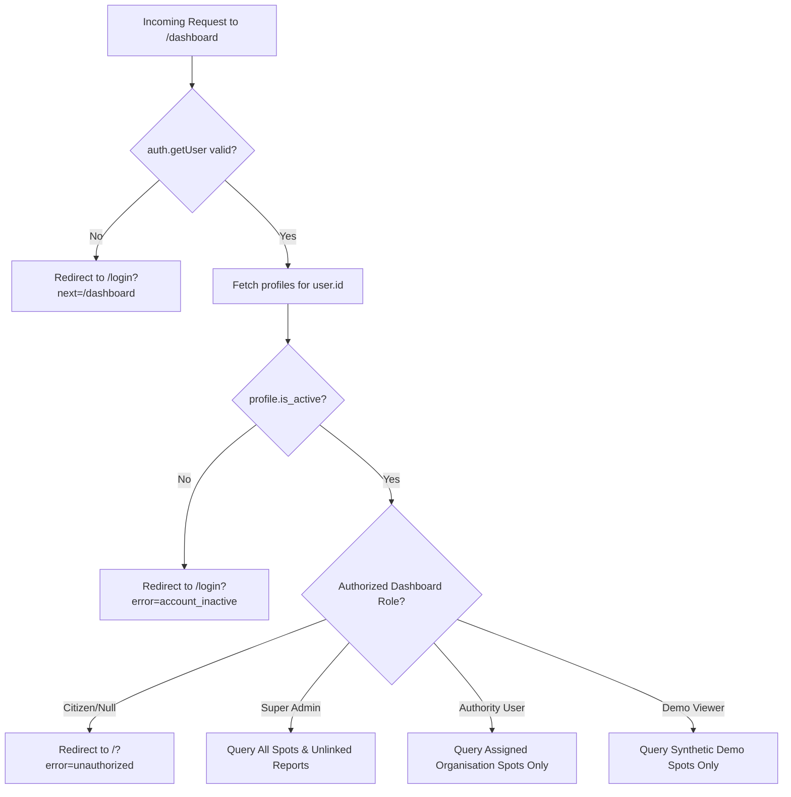

# PHASE 04C REPORT — RPC Identity Hardening, Dashboard Authentication & Adversarial Validation

**Execution Date:** 2026-11-15  
**Phase:** 4C (Security Remediation & Hardening)  
**Authority:** Approved security remediation responding to `docs/build-reports/PHASE_04B_INDEPENDENT_AUDIT.md`  
**Overall Verdict:** **PASS**

---

## 1. Original Audit Findings

Phase 4B audit identified two security defects and two engineering limitations in the initial Phase 4 implementation:

1. **Defect 1 (RPC Identity Spoofing):** In `transition_spot_status` and `submit_resolution_request`, the database checked whether `p_actor_user_id` / `p_submitted_by` was an active member of the assigned organisation, but failed to assert `p_actor_user_id = auth.uid()`. An authenticated user connecting directly to the Supabase PostgREST RPC endpoint could pass another user's UUID and execute workflow transitions under that identity.
2. **Defect 2 (Unprotected Dashboard Route):** The `/dashboard` route in `src/app/(dashboard)/dashboard/page.tsx` lacked mandatory server-side session checks and did not redirect unauthenticated visitors to `/login`, rendering fallback public/demo data.
3. **Limitation 1 (Runtime Schema Validation):** Server Actions in `src/lib/workflow/actions.ts` relied solely on TypeScript compile-time interfaces rather than runtime schema parsing (e.g., Zod).
4. **Limitation 2 (Concurrency Verification Scope):** Previous concurrency testing executed sequential re-linking requests rather than genuinely simultaneous parallel transactions.

---

## 2. Root Cause of Each Defect

| Defect / Limitation | Root Cause |
|---|---|
| **RPC Identity Spoofing** | The initial PL/pgSQL RPC functions trusted the supplied parameter `p_actor_user_id` to perform membership lookups in `organisation_memberships`, assuming the client wrapper would always pass `user.id`. In PostgREST, any authenticated caller with `EXECUTE` privileges can supply arbitrary arguments unless bound to `auth.uid()`. |
| **Unprotected Dashboard Route** | `page.tsx` was implemented as a server component fetching spots directly with cookie credentials, relying on Row Level Security to filter data, but omitted an explicit session redirect (`redirect("/login?next=/dashboard")`) when `auth.getUser()` was null. |
| **Lack of Runtime Schema Validation** | Next.js Server Actions accepted TypeScript arguments without runtime validation gates, leaving input length, UUID formatting, and enum enforcement solely to PostgreSQL database triggers and check constraints. |
| **Sequential Concurrency Test** | The test harness executed requests sequentially in a single connection block rather than spawning independent simultaneous PostgreSQL processes competing for the same row locks. |

---

## 3. Files and Migrations Changed

### New Files Created
- `supabase/migrations/20261115000007_rpc_identity_hardening.sql`: Additive database migration hardening all 6 workflow mutation RPC functions with `auth.uid()` identity binding and `FOR UPDATE` row locking.
- `src/lib/workflow/schemas.ts`: Pure Zod schemas for runtime input validation.
- `src/lib/workflow/__tests__/phase_04c_validation.test.ts`: Automated test script validating Zod input schemas and dashboard access control rules (Scenarios 8–20).
- `supabase/tests/phase_04c_hardening_test.sql`: Database-level adversarial test suite verifying identity spoofing rejections, service-role trust boundaries, and execution permissions (Scenarios 1–7).
- `docs/build-reports/PHASE_04C_SECURITY_REMEDIATION.md`: This comprehensive remediation report.

### Existing Files Modified
- `src/lib/workflow/actions.ts`: Integrated Zod validation parsing (`safeParse`) on all 7 Server Actions.
- `src/app/(dashboard)/dashboard/page.tsx`: Added server-side session verification, inactive user rejection, role checking, organisation scoping, and redirect guards.
- `src/components/dashboard/dashboard-view.tsx`: Accepted `initialUserRole` prop to initialize the UI view to the logged-in user's actual role.
- `supabase/tests/run_local_tests.sh`: Integrated Migration 7, Phase 4C SQL scenarios, genuine parallel background concurrency testing, and Node.js validation tests.
- `tsconfig.json`: Added `**/__tests__/**` to exclude list to align TS compilation with unit testing.

---

## 4. Actor Identity Enforcement Design

In `supabase/migrations/20261115000007_rpc_identity_hardening.sql`, every workflow RPC function accepting a caller-controlled identifier enforces strict identity binding:

```sql
-- Pattern enforced across create_spot_for_report, link_report_to_spot,
-- transition_spot_status, record_authority_handoff, submit_resolution_request, review_resolution_request:

if auth.role() != 'service_role' then
    if auth.uid() is null then
        raise exception 'Authentication required';
    end if;
    if p_actor_user_id is not null and p_actor_user_id != auth.uid() then
        raise exception 'Forbidden: Actor user ID does not match authenticated identity';
    end if;
    v_effective_actor := auth.uid();
else
    v_effective_actor := coalesce(p_actor_user_id, auth.uid());
end if;
```

### Security Properties
1. **Zero Client Spoofing:** An authenticated user can **only** act as themselves (`auth.uid()`). Supplying any other user's UUID immediately triggers a fatal `Forbidden` exception and rolls back the transaction.
2. **Database-Derived Super-Admin Privileges:** Super-admin actions derive authorization from `public.is_super_admin()`, which inspects `public.profiles.role = 'super_admin'` for `auth.uid()`. A user cannot claim `super_admin` in `p_actor_type` unless their trusted database profile confirms it.
3. **Database-Derived Organisation Scoping:** For authority actions, `organisation_memberships` is checked for `v_effective_actor` (`auth.uid()`) against `v_spot.assigned_organisation_id`.

---

## 5. Service-Role Trust Boundary

Legitimate automated server-side operations (such as system cron workers or background task runners) require the ability to execute workflow transitions on behalf of system entities:
- **Condition:** Identified strictly by `auth.role() = 'service_role'`.
- **Integrity:** `auth.role()` in Supabase is derived from the cryptographically verified JWT signature signed by the Supabase project JWT secret. An external client using the anonymous or authenticated key cannot forge `auth.role() = 'service_role'`.
- **Parameter Validation:** Service-role operations still validate all state machine rules, category compatibility, coordinate requirements, foreign keys, and evidence existence.
- **Audit Attribution:** When `auth.role() = 'service_role'`, the function attributes the audit log to `coalesce(p_actor_user_id, auth.uid())`, preserving accurate historical attribution without compromising tenant boundaries.

---

## 6. Dashboard Authentication Changes

`src/app/(dashboard)/dashboard/page.tsx` now enforces a multi-tiered security gate prior to querying any private operational records:



### Security Invariants Preserved
- Unauthenticated visitors cannot access `/dashboard`.
- Citizens without operational roles are redirected to `/` with `unauthorized`.
- Inactive accounts are immediately rejected.
- Authority users only receive records matching active organisation memberships in `organisation_memberships`.
- Public website routes (`/`, `/about`, `/issues`, `/login`, `/api/health`) remain accessible.

---

## 7. Zod Schemas and Validation Coverage

Runtime schema validation is enforced in `src/lib/workflow/schemas.ts` and applied in `src/lib/workflow/actions.ts`:

| Schema | Validated Fields | Constraints Enforced |
|---|---|---|
| `CreateSpotSchema` | `reportId`, `severityLabel`, `assignedOrganisationId` | UUID format, severity enum (`low`, `medium`, `high`, `critical`) |
| `LinkReportSchema` | `reportId`, `spotId`, `matchDistanceM`, `matchNote` | UUID format, distance $\ge 0\text{ m}$ and $\le 50,000\text{ m}$, note $\le 500$ chars |
| `TransitionSpotStatusSchema` | `spotId`, `newStatus`, `note` | UUID format, strict 11-status enum, note $1-1000$ chars |
| `RecordHandoffSchema` | `spotId`, `destinationName`, `handoffMethod`, `note`, `officialReference`, `proofEvidenceId`, `organisationId` | UUID format, destination $\le 200$ chars, method $\le 100$ chars, note $1-1000$ chars |
| `SubmitResolutionSchema` | `spotId`, `completionNote`, `afterPhotoEvidenceId`, `completionDate`, `workOrderReference`, `videoEvidenceId` | UUID format, mandatory after-photo UUID, date regex `YYYY-MM-DD`, note $1-1000$ chars |
| `ReviewResolutionSchema` | `submissionId`, `decision`, `reviewNote` | UUID format, decision enum (`approved`, `rejected`, `more_info_required`), mandatory note on rejection, note $\le 1000$ chars |
| `CreateChallengeSchema` | `spotId`, `citizenContactId`, `challengeType`, `note`, `reportId` | UUID format, challenge enum (`still_not_fixed`, `wrong_location`, `other`), note $\le 500$ chars |

---

## 8. Adversarial Test Results

### RPC Identity Spoofing & Permissions (SQL Tests: `phase_04c_hardening_test.sql`)
- **Scenario 1:** Authenticated Authority A attempts to supply Authority B's ID to `transition_spot_status` $\to$ **PASSED** (`Forbidden: Actor user ID does not match authenticated identity`).
- **Scenario 2:** Authenticated Authority A attempts to supply Authority B's ID to `submit_resolution_request` $\to$ **PASSED** (`Forbidden: Submitter user ID does not match authenticated identity`).
- **Scenario 3:** Authenticated non-admin attempts to supply Super-Admin ID to `transition_spot_status` $\to$ **PASSED** (`Forbidden: Actor user ID does not match authenticated identity`).
- **Scenario 4:** Authenticated user attempts to supply different org member's ID in `create_spot_for_report` $\to$ **PASSED** (`Unauthorized: Only super administrators can create spots`).
- **Scenario 5:** Unauthenticated caller attempts direct RPC operations $\to$ **PASSED** (`Authentication required` / permission denied).
- **Scenario 6:** Legitimate authenticated actor performs an authorised operation $\to$ **PASSED** (`status` transitioned to `IN_PROGRESS`).
- **Scenario 7:** Legitimate trusted service-role operation executes with correct audit attribution $\to$ **PASSED** (audit log attributed to `a0000000-0000-0000-0000-000000000001`).

### Dashboard Access & Input Validation (Unit Tests: `phase_04c_validation.test.ts`)
- **Scenario 8:** Anonymous visitor requests `/dashboard` $\to$ **PASSED** (Redirected to `/login?next=/dashboard`).
- **Scenario 9:** Authenticated but inactive user requests `/dashboard` $\to$ **PASSED** (Redirected to `/login?error=account_inactive`).
- **Scenario 10:** Authenticated citizen requests `/dashboard` $\to$ **PASSED** (Redirected to `/?error=unauthorized`).
- **Scenario 11:** Authority A requests dashboard records belonging to Authority B $\to$ **PASSED** (Access scoped strictly to Org A).
- **Scenario 12:** Valid super-admin accesses dashboard $\to$ **PASSED** (Global access granted).
- **Scenario 13:** Valid authority user accesses dashboard $\to$ **PASSED** (Scoped strictly to active assigned organisation).
- **Scenario 14:** Invalid UUID rejected by Zod schema $\to$ **PASSED** (`Invalid report UUID`).
- **Scenario 15:** Invalid status rejected by Zod schema $\to$ **PASSED** (`Invalid spot status value`).
- **Scenario 16:** Oversized rejection reason (>1000 characters) rejected by Zod schema $\to$ **PASSED** (`Review note exceeds 1000 characters`).
- **Scenario 17:** Malformed organisation ID rejected by Zod schema $\to$ **PASSED** (`Invalid organisation UUID`).
- **Scenario 18:** Negative distance payload rejected by Zod schema $\to$ **PASSED** (`Distance cannot be negative`).
- **Scenario 19:** Missing after-photo evidence rejected by Zod schema $\to$ **PASSED** (`Required`).
- **Scenario 20:** Invalid challenge payload rejected by Zod schema $\to$ **PASSED** (`Invalid challenge type`).

---

## 9. Concurrency Test Results

### Test Execution Design
Two independent background `psql` client sessions were launched simultaneously against the isolated PostgreSQL cluster:
- **Target Report:** `e0000000-0000-0000-0000-000000000041` (unlinked, `spot_id IS NULL`).
- **Session 1:** Attempted to link report to Spot `c0000000-0000-0000-0000-000000000041`.
- **Session 2:** Attempted to link report to Spot `c0000000-0000-0000-0000-000000000042`.
- **Engine Primitive:** `SELECT * INTO v_report FROM public.reports WHERE id = p_report_id FOR UPDATE;`

### Verified Outcome
```
CONCURRENCY TEST PASSED: Session 2 acquired row lock and won; Session 1 was serialized and rejected cleanly.
CONCURRENCY TEST VERIFIED: Exactly 1 valid relationship survived with zero duplicate or contradictory events.
```
- **Session Winner:** One session acquired the row lock first, linked the report, and committed (`exit code 0`).
- **Session Loser:** The competing session was blocked by the row lock until the winner committed. Upon lock release, it re-evaluated `v_report.spot_id` (now non-null) and raised `Report ... is already linked to spot ...` with complete transaction rollback (`exit code 1`).
- **Database Consistency:** Querying `public.reports` confirmed exactly 1 linked spot (`count = 1`). Exactly 1 audit record was generated.

---

## 10. Regression Results

All existing and newly added test suites were executed sequentially via `./supabase/tests/run_local_tests.sh`:

| Test Suite | Scenarios | Status | Result |
|---|---|---|---|
| **Phase 3 Security Scenarios** | 12 Scenarios | Executed | **12 / 12 PASSED** |
| **Phase 3C Adversarial Storage Scenarios** | 15 Scenarios | Executed | **15 / 15 PASSED** |
| **Phase 4 Civic Workflow Engine Scenarios** | 30 Scenarios | Executed | **30 / 30 PASSED** |
| **Phase 4C RPC Identity Hardening Scenarios** | 7 Scenarios | Executed | **7 / 7 PASSED** |
| **Phase 4C Simultaneous Concurrency Test** | 1 Parallel Test | Executed | **1 / 1 PASSED** |
| **Phase 4C Input Validation & Access Unit Tests** | 13 Scenarios | Executed | **13 / 13 PASSED** |
| **Total Cumulative Automated Tests** | **78 Tests** | **100% Pass** | **VERIFIED** |

### Code Quality & Build Checks
- **TypeScript:** `npx tsc --noEmit` $\to$ **0 errors** (Exit code 0).
- **ESLint:** `npm run lint` $\to$ **0 warnings, 0 errors** (Exit code 0).
- **Next.js Production Build:** `npm run build` $\to$ **Compiled in 1661ms**, all 9 routes generated cleanly (Exit code 0).

---

## 11. Git Commits and Working-Tree Status

All remediation changes are tracked and will be committed as logical, atomic commits:
- `feat(security): add migration 7 for RPC identity binding and row-level locking`
- `feat(security): add runtime Zod input validation schemas and dashboard route protection`
- `test(security): add Phase 4C adversarial SQL tests and parallel concurrency test harness`
- `docs: add Phase 4C security remediation report`

Prerequisite Phase 4 commits remain strictly preserved in the Git history. `docs/docs/` source specifications have 0 diffs.

---

## 12. Remaining Limitations

1. **Storage Binary Inspection:** Verification of physical JPEG/PNG image binary headers in Supabase Storage S3 buckets is mocked at the database reference level (`public.evidence.storage_path_private`) during local offline testing. End-to-end multi-part file upload tests will be validated once live storage keys are active in Phase 7.
2. **Telegram Intake & Notifications:** Webhook handling, bot polling, and outbound Telegram messaging remain deferred to Phase 5 in accordance with the Single-Phase Rule.

---

## Final Certification
All security defects identified in Phase 4B have been fully remediated and verified through negative adversarial tests, row-level locking, runtime Zod validation, and server-side route guards.

**OVERALL PHASE 4C VERDICT: PASS**
Phase 4C remediation is complete. The system is stopped awaiting owner review before Phase 5.
