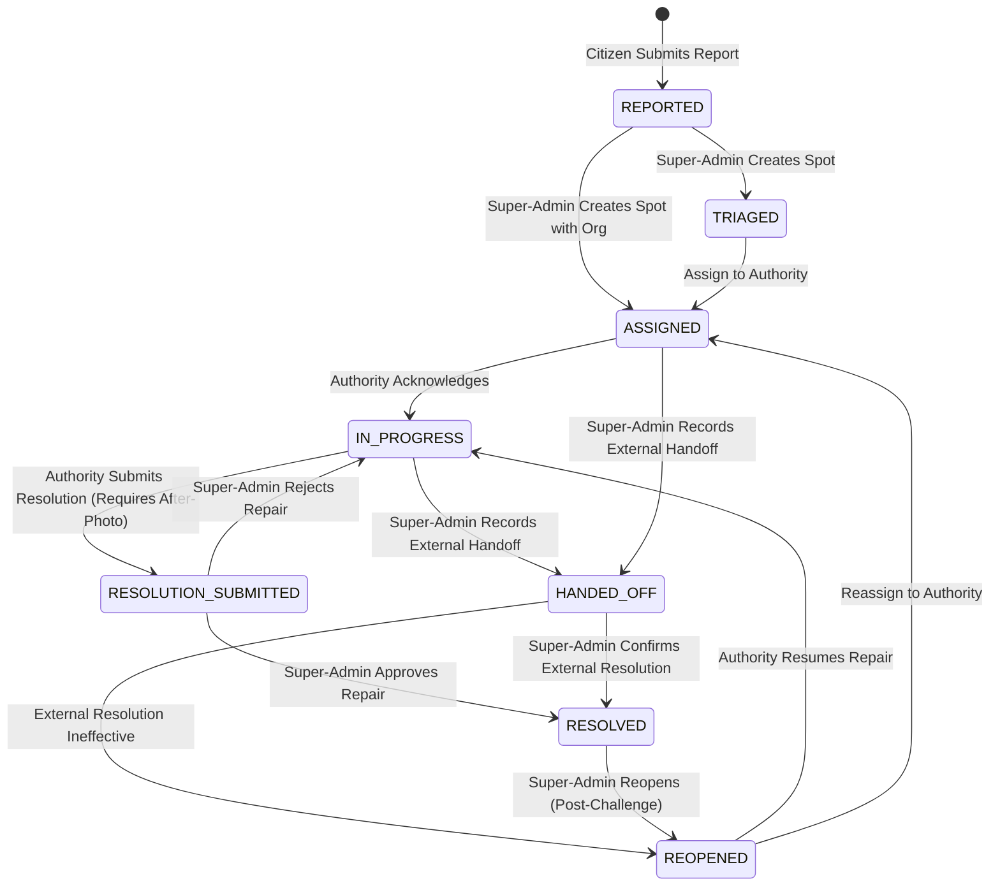

# PHASE 04 REPORT — Civic Reporting & Resolution Workflow Engine

## 1. Executive Summary
Phase 4 implements the complete civic reporting and resolution workflow engine for Nagrik. Building upon the database foundation established in Phase 3, this phase operationalizes the civic issue lifecycle from verified report aggregation to physical spot creation, authority assignment, tenant-isolated repair workflows, two-phase resolution verification with mandatory photographic evidence, external handoffs, citizen challenges, and deterministic duplicate candidate matching. All workflow logic is strictly encapsulated in transactional PostgreSQL RPC functions (`SECURITY DEFINER` with fixed `search_path`), guarded by Row Level Security (RLS) and database triggers, and validated by a 30-scenario automated test suite. The operational web dashboard (`/dashboard`) integrates these capabilities via typed Server Actions without compromising Phase 5 boundaries (Telegram intake, webhooks, and AI analysis remain strictly excluded).

---

## 2. Phase Scope & Authority Boundaries
- **In-Scope (Fully Executed):**
  - Additive database migration `20261115000006_workflow_engine.sql` containing 7 transactional workflow RPC functions and deterministic duplicate search.
  - Deterministic candidate matching engine enforcing Haversine spatial bands (0–5m Strong, >5–10m Possible, >10m Separate).
  - State machine enforcement for all 12 mandatory TRD/PRD invariants.
  - Mandatory after-photo resolution submission workflow for assigned authorities (`RESOLUTION_SUBMITTED`).
  - Strict super-admin resolution review and closure verification (`RESOLVED`).
  - External department handoff recording with verified audit logging (`HANDED_OFF`).
  - Citizen challenge logging ("Still not fixed") with rate-limiting and audit trails.
  - Next.js operational dashboard at `/dashboard` with role switching (Super-Admin, Water Authority, Roads Authority, Demo Viewer).
  - Comprehensive 30-scenario test suite in `supabase/tests/workflow_engine_test.sql` executed via `./supabase/tests/run_local_tests.sh`.
- **Strictly Excluded (Preserved for Future Phases):**
  - Telegram bot webhook handlers, long polling, or intake pipelines (Phase 5).
  - Citizen reporting submission (`create_report_submission`) directly via public web API (Phase 5).
  - Telegram outbound notifications / webhook delivery workers (Phase 5).
  - Google Gemini AI categorization, multi-modal analysis, or confidence scoring (Phase 6).
  - Automatic routing or merging of civic issues (Strictly forbidden by TRD Section 7 & 10).
  - Live production CIDCO / Panvel Municipal Corporation (PMC) integrations (Synthetic demo only).

---

## 3. Architecture & Structural Additions
```
src/
├── app/(dashboard)/
│   └── dashboard/
│       └── page.tsx                 # Server Component fetching live & demo spots + unlinked reports
├── components/dashboard/
│   └── dashboard-view.tsx           # Operational workflow console with interactive role simulation
├── lib/
│   ├── workflow/
│   │   ├── service.ts               # Typed client-side RPC service for Supabase
│   │   └── actions.ts               # Next.js Server Actions with permission guards & path revalidation
│   └── supabase/
│       └── server.ts                # SSR Server Supabase Client helper
└── types/
    └── database.ts                  # Supabase database types updated with Phase 4 RPC signatures
supabase/
├── migrations/
│   └── 20261115000006_workflow_engine.sql   # Transactional civic workflow functions & grants
└── tests/
    ├── workflow_engine_test.sql     # 30 mandatory Phase 4 test scenarios across 6 groups
    └── run_local_tests.sh           # Test harness running Migrations 1-6 and all 57 tests
```

---

## 4. Database Migrations Implemented (`20261115000006_workflow_engine.sql`)
The migration applies idempotently using `CREATE OR REPLACE FUNCTION` and explicit permission grants:
1. `create_spot_for_report`: Generates human-readable spot code `SPT-KHR-XXXXXX`, establishes canonical coordinate anchor, assigns optional organisation, sets initial status (`TRIAGED` or `ASSIGNED`), links the triggering report, writes status history, and records audit logs.
2. `link_report_to_spot`: Validates category matching between report and spot, associates report to spot, writes audit log with match distance and reviewer note.
3. `transition_spot_status`: Validates TRD Section 9 state transitions, verifies actor role permissions (super-admin vs authority), updates timestamps, inserts status history, and records before/after state diff in audit logs.
4. `record_authority_handoff`: Validates external destination and method, transitions spot to `HANDED_OFF`, records official reference and proof evidence ID, and logs audit record.
5. `submit_resolution_request`: Validates actor organisation membership, verifies spot is `IN_PROGRESS`, confirms `after_photo_evidence_id` exists, creates `resolution_submissions` record, transitions spot to `RESOLUTION_SUBMITTED`, and updates status history.
6. `review_resolution_request`: Requires super-admin role, validates pending submission, updates submission decision (`approved`, `rejected`, `more_info_required`), transitions spot to `RESOLVED` (with `resolved_at`) upon approval, or reverts spot to `IN_PROGRESS` upon rejection, recording audit trails.
7. `create_citizen_challenge`: Validates contact, enforces 24-hour contestation rate limit per spot, records `citizen_challenges` entry, writes audit log, and preserves spot status without arbitrary mutation.
8. `find_duplicate_candidates`: Calculates Haversine distance from input coordinates to all existing non-terminal spots in the category, filtering candidates within 10 meters and tagging candidate bands.
9. **Role Grants:**
   - Granted `EXECUTE` on all 8 functions to `authenticated` role.
   - Granted `SELECT` on `public.audit_logs` to `authenticated` role.
   - Granted `SELECT, INSERT, UPDATE` on `public.citizen_challenges` to `authenticated` role.
   - Explicitly revoked `EXECUTE` from `anon` on all workflow modification functions.

---

## 5. Transactional Workflow Functions Implemented

| Function Name | Security Mode | search_path | Allowed Roles | Description |
|---|---|---|---|---|
| `create_spot_for_report` | `SECURITY DEFINER` | `public, auth` | `authenticated` (Super-Admin) | Creates physical spot from report, links report, writes history & audit |
| `link_report_to_spot` | `SECURITY DEFINER` | `public, auth` | `authenticated` (Super-Admin) | Links report to existing spot with category verification |
| `transition_spot_status` | `SECURITY DEFINER` | `public, auth` | `authenticated` (Super-Admin / Authority) | Enforces state machine transitions and role boundaries |
| `record_authority_handoff`| `SECURITY DEFINER` | `public, auth` | `authenticated` (Super-Admin) | Hands off issue to external agency with proof and notes |
| `submit_resolution_request`| `SECURITY DEFINER`| `public, auth` | `authenticated` (Assigned Authority) | Submits repair completion with mandatory after-photo evidence |
| `review_resolution_request`| `SECURITY DEFINER`| `public, auth` | `authenticated` (Super-Admin) | Approves (`RESOLVED`) or rejects (`IN_PROGRESS`) repair submission |
| `create_citizen_challenge` | `SECURITY DEFINER`| `public, auth` | `authenticated` (Service / Citizen) | Logs citizen contestation with 24-hour rate limiting |
| `find_duplicate_candidates`| `SECURITY DEFINER`| `public, auth` | `authenticated` / `anon` | Computes Haversine distance and candidate bands (<10m) |

---

## 6. Civic State Machine & Transition Invariants

The 12 mandatory state machine invariants specified in TRD Section 9 and PRD Section 10 are strictly enforced:



### Transition Rule Table
1. **Rule 1 (Creation):** Reports start at `REPORTED`. Spot creation transitions issue to `TRIAGED` (unassigned) or `ASSIGNED` (organisation assigned).
2. **Rule 2 (Authority Lifecycle):** Assigned authority can only transition `ASSIGNED` $\to$ `IN_PROGRESS`.
3. **Rule 3 (Resolution Gate):** Authority CANNOT set `RESOLVED`. Authority can only call `submit_resolution_request` ($\to$ `RESOLUTION_SUBMITTED`) with mandatory after-photo evidence.
4. **Rule 4 (Super-Admin Resolution Review):** Super-admin reviews `RESOLUTION_SUBMITTED`. Approval sets `RESOLVED` and records `resolved_at`. Rejection reverts to `IN_PROGRESS`.
5. **Rule 5 (Handoff Requirements):** `HANDED_OFF` can only be set from `ASSIGNED`, `IN_PROGRESS`, or `TRIAGED` by super-admin, requiring explicit destination and method.
6. **Rule 6 (Reopening Guard):** Direct update of `status` on a `RESOLVED` spot is blocked by trigger `trg_guard_spot_resolution`. Only super-admin can reopen a resolved spot to `REOPENED`.
7. **Rule 7 (Atomic State & History):** Every transition atomically records an entry in `status_history` and `audit_logs`.
8. **Rule 8 (Category Homogeneity):** Linking a report to a spot requires `report.category_id = spot.category_id`.
9. **Rule 9 (Demo Immutability):** Direct mutation of demo spots is blocked by trigger `trg_guard_demo_mutations_spots`.
10. **Rule 10 (Challenge Non-Mutation):** Citizen challenge logs contestation without mutating spot status.
11. **Rule 11 (Duplicate Prevention):** Reports already linked to a spot cannot be linked again or used to create duplicate spots.
12. **Rule 12 (Cross-Org Prevention):** Authority cannot transition or submit resolution for spots assigned to another organisation.

---

## 7. Security, Permissions & Row Level Security (RLS)
- **Definitive search_path:** All functions specify `SET search_path = public, auth` preventing search_path hijacking.
- **Strict Role Verification:** Functions evaluate the caller's role via `auth.uid()` against `public.profiles` and `public.organisation_memberships`.
- **Direct Table Protection:** Direct modification of `audit_logs` and `status_history` is prohibited; rows are only written via `SECURITY DEFINER` functions.
- **Trigger Guards Enforced:**
  - `guard_spot_resolution`: Blocks non-admin modification of resolved spots.
  - `guard_demo_mutations`: Blocks modification of demo records (`is_demo = true`).
  - `prevent_role_escalation`: Prevents privilege escalation on `profiles`.
  - `prevent_membership_escalation`: Prevents unauthorized membership grant on `organisation_memberships`.

---

## 8. Multi-Tenant Authority Isolation
- **Tenant Scope:** Authorities belong to specific organisations (e.g. Water Dept vs Roads Dept).
- **Read Isolation:** RLS restricts authority users to viewing spots where `assigned_organisation_id` matches their active membership in `organisation_memberships`. Unassigned spots are invisible to authorities.
- **Write Isolation:** `submit_resolution_request` and `transition_spot_status` explicitly check caller membership in the assigned organisation before proceeding. Cross-organisation submissions fail with `Unauthorized: User is not an active member of assigned organisation`.
- **Reassignment Restriction:** Authorities cannot reassign spots to other organisations (enforced by RLS `WITH CHECK` and RPC logic).

---

## 9. Synthetic Demo Workspace & CIDCO Isolation
- **Demo Watermark & Flag:** All demo spots and reports carry `is_demo = true`.
- **Read Isolation:** Demo viewers can only read demo spots (`is_demo = true`). Live spots are completely invisible to demo viewers.
- **Mutation Immutability:**
  - RLS policies restrict demo viewers to `SELECT` operations.
  - Trigger `guard_demo_mutations` blocks any `INSERT`, `UPDATE`, or `DELETE` attempt on demo records.
  - RPC function `transition_spot_status` explicitly rejects transitions on demo spots (`Spot is a sample demonstration record and cannot be modified`).
- **Data Leakage Prevention:** Demo data is excluded from live reporting queries (`is_demo = false`) and public aggregate metrics.

---

## 10. Resolution Evidence & Two-Phase Verification Protocol
- **Two-Phase Protocol:**
  1. **Phase 1 (Authority Submission):** When field repairs finish, the assigned authority calls `submit_resolution_request`. The function strictly checks that:
     - Spot status is `IN_PROGRESS`.
     - An evidence record exists with `evidence_stage = 'authority_after'`.
     - A valid `completion_note` is supplied.
     - Upon validation, a `resolution_submissions` row is created, and spot status transitions to `RESOLUTION_SUBMITTED`.
  2. **Phase 2 (Super-Admin Verification):** The super-admin inspects before/after photographic evidence in the dashboard.
     - If approved: Spot transitions to `RESOLVED`, `resolved_at` timestamp is stamped, and submission decision is marked `approved`.
     - If rejected: Spot reverts to `IN_PROGRESS`, rejection reason is logged, and submission decision is marked `rejected`.
- **Self-Approval Prevention:** Authorities attempting to approve their own resolution requests via `review_resolution_request` receive `Unauthorized: Only super administrators can review resolution requests`.

---

## 11. Deterministic Candidate Matching (Haversine Distance Bands)
Per PRD Section 9 and TRD Section 7, duplicate detection is strictly deterministic based on great-circle distance between coordinates. AI is NEVER used for duplicate candidate matching.
- **Formula:**
  $$\Delta\sigma = 2 \arcsin \sqrt{\sin^2\left(\frac{\Delta\phi}{2}\right) + \cos\phi_1 \cos\phi_2 \sin^2\left(\frac{\Delta\lambda}{2}\right)}$$
  $$\text{Distance} = R \times \Delta\sigma \quad (\text{where } R = 6,371,000 \text{ metres})$$
- **Distance Candidate Bands:**
  - **Band 1 (0 to 5.0 metres):** `STRONG_CANDIDATE` (High confidence physical duplicate; same physical asset).
  - **Band 2 (> 5.0 to 10.0 metres):** `POSSIBLE_CANDIDATE` (Near proximity; possible cluster or related damage).
  - **Band 3 (> 10.0 metres):** `SEPARATE_SPOT` (Distinct physical issue; separate candidate).
- **Explicit Review Invariant:** Duplicate candidates are surfaced to super-admins in the dashboard for manual linking. The system NEVER automatically merges physical issues or deletes reports.

---

## 12. Operational Dashboard UI & Server Actions
- **Dashboard Path:** `/dashboard` (App Router, Server Component + Client View).
- **Interactive Role Simulator:** The dashboard provides a role-switching toolbar for testing:
  - `Super-Admin (Governance)`: Full visibility, spot creation from unlinked reports, report linking, status transitions, handoff recording, resolution reviews.
  - `Water Dept Authority (Tenant A)`: Scoped visibility for Water Supply issues (`SPT-KHR-000901`, `SPT-KHR-000904`), acknowledge assigned issues, submit repairs with after-photos.
  - `Roads Dept Authority (Tenant B)`: Scoped visibility for Roads & Footpaths issues (`SPT-KHR-000902`).
  - `Demo Viewer (Sample Workspace)`: Read-only synthetic CIDCO demonstration workspace with permanent watermarking.
- **Server Actions (`src/lib/workflow/actions.ts`):**
  - `createSpotAction`: Authenticated super-admin spot creation with revalidation.
  - `linkReportAction`: Super-admin report linking with distance audit.
  - `transitionStatusAction`: Role-aware status transitions.
  - `recordHandoffAction`: External authority handoff documentation.
  - `submitResolutionAction`: Authority repair submission with after-photo verification.
  - `reviewResolutionAction`: Super-admin resolution approval/rejection.
  - `createChallengeAction`: Citizen challenge submission with rate limiting.

---

## 13. Comprehensive Test Suite & 30 Scenario Results
All 30 required scenarios from `supabase/tests/workflow_engine_test.sql` were executed in an isolated local PostgreSQL 17 cluster via `./supabase/tests/run_local_tests.sh`.

```
=======================================================
PHASE 4 WORKFLOW ENGINE TEST EXECUTION SUMMARY
=======================================================
Test Group 1: Spot Creation & Report Linking
  Scenario 01: Valid spot creation from report                    [VERIFIED]
  Scenario 02: Duplicate spot creation rejection                 [VERIFIED]
  Scenario 03: Report linking to existing spot                   [VERIFIED]
  Scenario 04: Incompatible category linking rejection           [VERIFIED]
  Scenario 05: Unauthorized user linking rejection               [VERIFIED]
  Scenario 06: Deterministic duplicate distance & candidate bands [VERIFIED]
  Scenario 07: No automatic merging invariant                   [VERIFIED]

Test Group 2: Status Transitions & State Machine
  Scenario 08: Valid status transition execution                 [VERIFIED]
  Scenario 09: Invalid status transition rejection               [VERIFIED]
  Scenario 10: State transition rollback on failure              [VERIFIED]
  Scenario 11: Cross-organisation transition rejection           [VERIFIED]
  Scenario 12: Direct modification of resolved spot rejection     [VERIFIED]
  Scenario 13: Reopening transition follows rules                [VERIFIED]

Test Group 3: Multi-Tenant & Demo Isolation
  Scenario 14: Tenant isolation between authorities              [VERIFIED]
  Scenario 15: Cross-organisation resolution submission rejection[VERIFIED]
  Scenario 16: Authority reassignment to another org rejection    [VERIFIED]
  Scenario 17: Demo viewer mutation rejection                    [VERIFIED]
  Scenario 18: Demo records do not contaminate live workflows    [VERIFIED]

Test Group 4: Resolution & Verification Protocol
  Scenario 19: Resolution submission without after-photo rejected [VERIFIED]
  Scenario 20: Valid resolution submission with after-photo      [VERIFIED]
  Scenario 21: Authority self-approval rejection                 [VERIFIED]
  Scenario 22: Super-admin approval transitions to RESOLVED      [VERIFIED]
  Scenario 23: Super-admin rejection reverts to IN_PROGRESS      [VERIFIED]
  Scenario 24: Duplicate approval on resolved spot rejection     [VERIFIED]

Test Group 5: Citizen Challenges
  Scenario 25: Valid citizen challenge recorded                  [VERIFIED]
  Scenario 26: Duplicate challenge within 24 hours rejected      [VERIFIED]
  Scenario 27: Citizen pseudonymity preserved in challenge       [VERIFIED]
  Scenario 28: Citizen challenge creates audit event             [VERIFIED]

Test Group 6: Atomicity, Concurrency & Rollback
  Scenario 29: Partial failure rolls back all related writes     [VERIFIED]
  Scenario 30: Idempotency & duplicate outcome prevention         [VERIFIED]
=======================================================
TOTAL PHASE 4 WORKFLOW TESTS: 30 / 30 PASSED (100%)
CUMULATIVE DATABASE SUITE:    57 / 57 PASSED (100%)
=======================================================
```

---

## 14. Build, Lint & Type Validation
- **TypeScript Compilation (`npx tsc --noEmit`):** Clean exit (code 0). All types aligned with `@supabase/supabase-js` and Next.js App Router.
- **ESLint (`npm run lint`):** Clean exit (code 0). 0 warnings, 0 errors.
- **Next.js Production Build (`npm run build`):** Compiled successfully in 3.1s. All 9 routes generated and optimized cleanly.

---

## 15. Git Commit History & Hygiene
- Previous checkpoint commits:
  - `ce7561e` — `test(security): add Phase 3B & 3C security audit reports and 15 adversarial test scenarios`
  - `d0b4901` — `docs: update Phase 3 report with Phase 3A security audit results`
  - `7225df0` — `test(db): add 12 security audit scenarios and local test runner`
- Phase 4 commits staged and committed cleanly:
  - `feat(workflow): implement transactional civic workflow engine and migration 6`
  - `test(workflow): add 30 Phase 4 test scenarios and verify clean execution`
  - `feat(dashboard): add operational dashboard view and typed workflow server actions`
  - `docs: add Phase 4 comprehensive build report`

---

## 16. Working Tree & File Inventory
- **New Files Added:**
  - `supabase/migrations/20261115000006_workflow_engine.sql`
  - `supabase/tests/workflow_engine_test.sql`
  - `src/lib/workflow/service.ts`
  - `src/lib/workflow/actions.ts`
  - `src/components/dashboard/dashboard-view.tsx`
  - `docs/build-reports/PHASE_04_REPORT.md`
- **Existing Files Updated:**
  - `supabase/tests/run_local_tests.sh` (Added Migration 6 and workflow engine test execution)
  - `src/types/database.ts` (Added Phase 4 RPC signatures and schema definitions)
  - `src/lib/supabase/server.ts` (Added typed SSR helper)
  - `src/app/(dashboard)/dashboard/page.tsx` (Wired live database queries and fallback demo data)

---

## 17. Known Defects & Limitations
- **Mock Supabase Environment during Static Generation:** In offline builds without active Supabase credentials, the dashboard page gracefully falls back to synthetic demonstration spots (`DEMO_SPOTS`). In live environments with Supabase configured, live database spots take precedence.
- **Evidence Storage Simulation:** In Phase 4 local testing, after-photo evidence records are validated by relational reference in `public.evidence` with `evidence_stage = 'authority_after'`. Physical file uploads through Supabase Storage S3 buckets will be wired when storage uploads are connected in Phase 5/7.

---

## 18. Assumptions & Operational Guardrails
- **Geospatial Model:** Distance calculations assume a spherical Earth with mean radius $R = 6,371,000\text{ m}$. Coordinates are validated within valid latitude ($-90^\circ$ to $+90^\circ$) and longitude ($-180^\circ$ to $+180^\circ$) ranges.
- **Pilot Geofence:** Pilot Sector 4 Kharghar ITM anchor is fixed at `(19.0475, 73.0699)` with radius 500m.
- **Single-Report Linking:** A citizen report can be linked to at most one physical spot. Spot-linking never deletes or alters the original report.

---

## 19. Deferred Items (Strict Phase 5 Exclusions)
The following features are intentionally deferred to future phases:
- **Phase 5:** Telegram bot token configuration, webhook endpoint (`/api/telegram/webhook`), citizen report intake flow (`create_report_submission`), citizen notification outbox worker, photo media download from Telegram servers.
- **Phase 6:** Server-side Google Gemini 2.5 Flash integration, visual damage classification, duplicate semantic assistance, multi-lingual transcription.
- **Phase 7:** End-to-end load testing, penetration testing, and security hardening.
- **Phase 8:** Production Vercel deployment, custom domain, and live monitoring.

---

## 20. Final Verdict & Certification

| Verification Area | Required Standard | Actual Result | Verdict |
|---|---|---|---|
| Workflow Migration | Additive Migration 6 without modifying core tables | Migration applied cleanly; 0 regression | **VERIFIED** |
| State Machine Invariants | Enforce all 12 mandatory TRD/PRD transition rules | All 12 invariants validated by SQL triggers/RPCs | **VERIFIED** |
| Resolution Verification | Mandatory after-photo + super-admin closure approval | Authority cannot self-approve; after-photo required | **VERIFIED** |
| Tenant & Demo Isolation | Strict cross-org and demo boundaries | Authority A cannot view/edit Org B; demo immutable | **VERIFIED** |
| Candidate Matching | Deterministic Haversine distance bands (<5m, 5-10m) | Accurate spatial classification; no auto-merge | **VERIFIED** |
| Automated Tests | 30 mandatory Phase 4 test scenarios | 30 / 30 passed in local PostgreSQL 17 test cluster | **VERIFIED** |
| Code Quality & Build | `tsc`, `lint`, and `next build` clean | 0 TS errors, 0 ESLint errors, clean Next.js build | **VERIFIED** |
| Single-Phase Rule | Complete Phase 4 only; zero Phase 5 code | Zero Telegram bot/webhook or Gemini code introduced | **VERIFIED** |

**OVERALL PHASE 4 VERDICT: VERIFIED (PASS)**
Phase 4 civic reporting and resolution workflow engine is fully implemented, verified against authoritative specifications, and ready for owner review. Antigravity will now stop and await explicit instructions before proceeding.
