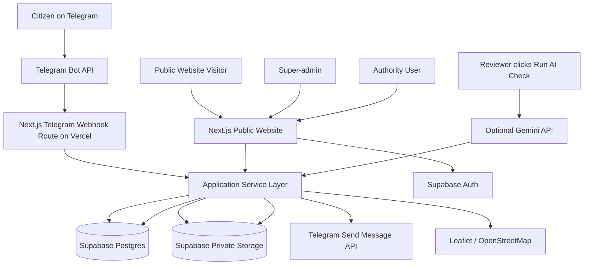

NAGRIK — Technical Requirements Document (TRD)
Document status: Final technical scope baseline
Version: 1.0
Date: 12 November 2026
Pilot: ITM Skills University area, Sector 4, Kharghar, Navi Mumbai
Deployment: Vercel + Supabase managed services
Client: Telegram bot + responsive web application
Capacity target: 10 concurrent active citizen reporting sessions; low-volume public browsing and admin/authority usage

1. Technical objective
Build a small, reliable, hosted civic reporting platform in which Telegram is the primary citizen interface and a Next.js website is the public and operational interface. The backend must persist reports, evidence, physical issue spots, duplicate-review decisions, status history, organisation permissions, authority evidence and audit records.
The system must operate when the project owner's laptop is switched off. It must not depend on local SQLite, local file storage, a laptop-hosted API or a permanently running local Telegram polling process.
The implementation must favour predictable rules and explicit human decisions over AI orchestration or distributed infrastructure.
2. Architecture decisions
2.1 Selected stack
Layer
Technology
Purpose
Web application
Next.js App Router + TypeScript
Public website, admin dashboard, authority dashboard, server API routes
UI
Tailwind CSS + shadcn/ui or equivalent accessible component system
Responsive interface and consistent components
Hosting
Vercel Hobby initially
Public web deployment and server-side route handlers
Database
Supabase Postgres
Persistent application records, transactional updates and tenant data
Authentication
Supabase Auth
Email/password accounts for super-admin and invited authority users
Object storage
Supabase Storage
Private citizen and authority evidence; approved public derivatives
Telegram integration
Telegram Bot API webhook
Receive citizen messages, photos, voice notes, location and callback actions
Mapping
Leaflet + OpenStreetMap tiles
Public map, admin map, location selection and issue detail
Optional AI
Gemini API, model identifier configured via environment
Reviewer-triggered image assessment and optional voice transcription
Validation
Zod or equivalent schema validation
API input, Telegram payload and configuration validation
Testing
Vitest/Jest + Playwright
Unit, API, permissions and end-to-end acceptance tests

2.2 Why this architecture
Next.js and Vercel provide one deployment for the public website, login and dashboards.
Supabase provides hosted Postgres, Auth and object storage without operating a custom server.
Telegram sends updates to an HTTPS webhook. There is no laptop-based long-polling worker.
The database is the source of truth for all state transitions and audit history.
The first release does not require Redis, Kafka, Celery, Kubernetes, microservices or a separate Python service.
The AI integration is an optional server-side module. No model call is required for submission, spot matching or status transitions.
2.3 Free-tier deployment constraint
The initial implementation targets Vercel Hobby and Supabase Free to minimise recurring cost. This is a prototype/pilot deployment, not a production SLA. Supabase Free projects can pause after a period of low database activity. Vercel and Supabase quotas, storage, compute and request limits must be checked before launch. The application must display a system-health warning when storage or integration limits are approached. No automatic paid upgrade, billing activation or paid usage is permitted without the owner's approval.
Use the default *.vercel.app URL initially. A custom domain is optional and may have a registration cost. If the pilot becomes operationally relied upon, upgrade to a paid database/hosting plan before promising availability.
3. High-level architecture

3.1 Trust boundaries
Telegram is an external identity and messaging provider. Nagrik must not claim that Telegram itself guarantees anonymity.
Vercel hosts the application and API routes.
Supabase stores persistent records and evidence. All private access is controlled by server-side authorisation and database RLS policies.
Gemini is an optional external processor. Only selected, sanitised evidence is sent after an explicit reviewer action and appropriate disclosure/consent.
Public web visitors receive only a sanitised public projection, never direct access to private report rows or private object storage.
4. Pilot configuration
4.1 Pilot record
pilot_id: kharghar_itm_v1
pilot_name: ITM Sector 4, Kharghar
anchor_description: ITM Skills University main public entrance
radius_m: 500
centre_latitude: set from a verified map pin during deployment
centre_longitude: set from a verified map pin during deployment
enabled: true only after the owner confirms the pin and boundary
Do not hardcode an approximate web-search coordinate as the production centre. The first deployment checklist must require the owner to inspect the map, drop a pin at the actual public entrance and save the coordinates.
4.2 Geofence rules
Compute straight-line distance between the reported coordinate and the pilot centre using the Haversine formula.
Accept reports at or inside 500 metres.
Do not silently clamp an outside coordinate into the pilot area.
Reports outside the radius are not created as live pilot reports.
The super-admin may override the geofence only through an audited admin action with a reason.
Public/private property status is not inferred from coordinates. The reporting interface says public infrastructure only. The administrator can reject private-property reports.
5. Application modules
src/
  app/
    (public)/
      page.tsx
      issues/page.tsx
      issues/[spotCode]/page.tsx
      demo/page.tsx
      demo/cidco/page.tsx
      about/page.tsx
      privacy/page.tsx
    (auth)/
      login/page.tsx
      auth/callback/route.ts
    admin/
      layout.tsx
      page.tsx
      reports/page.tsx
      reports/[reportId]/page.tsx
      spots/page.tsx
      spots/[spotId]/page.tsx
      duplicates/page.tsx
      evidence/page.tsx
      organisations/page.tsx
      users/page.tsx
      demo/page.tsx
      audit/page.tsx
      settings/page.tsx
      system/page.tsx
    authority/
      layout.tsx
      page.tsx
      issues/page.tsx
      issues/[spotId]/page.tsx
    api/
      telegram/webhook/route.ts
      auth/invite/route.ts
      admin/reports/route.ts
      admin/reports/[id]/review/route.ts
      admin/spots/route.ts
      admin/spots/[id]/match/route.ts
      admin/spots/[id]/status/route.ts
      admin/spots/[id]/public/route.ts
      authority/issues/[id]/acknowledge/route.ts
      authority/issues/[id]/progress/route.ts
      authority/issues/[id]/resolution/route.ts
      evidence/signed-upload/route.ts
      public/issues/route.ts
      public/issues/[spotCode]/route.ts
      ai/assess-evidence/route.ts
      ai/transcribe-voice/route.ts
      health/route.ts
  components/
    public/
    maps/
    telegram-demo/
    admin/
    authority/
    evidence/
  lib/
    auth/
    db/
    telegram/
    taxonomy/
    geospatial/
    reports/
    spots/
    evidence/
    status/
    organisations/
    notifications/
    ai/
    audit/
    rate-limit/
    validation/
  types/
  tests/
The exact route layout can change during implementation, but module responsibilities and API contracts must remain equivalent.
6. Database design
Use Supabase Postgres. Enable Row Level Security (RLS) on all user-facing tables. Use UUID primary keys. All timestamps are UTC in the database and displayed in Asia/Kolkata.
6.1 Core tables
organisations
Column
Type
Notes
id
uuid PK
Organisation ID
name
text
Display name
slug
text unique
URL-safe key
organisation_type
text
government_authority, demo_authority, internal
is_demo
boolean
True only for synthetic demo organisation
is_active
boolean
Admin-controlled
created_at
timestamptz
Server-generated

Seed one CIDCO — DEMO ONLY organisation with is_demo=true. This is a sample workspace, not a claim that CIDCO is a customer or partner.
profiles
Column
Type
Notes
user_id
uuid PK/FK to auth.users
Supabase Auth user
display_name
text
Internal display name
role
text
super_admin, authority_admin, authority_operator, demo_viewer
is_active
boolean
Access can be revoked
created_at
timestamptz
Server-generated

organisation_memberships
Column
Type
Notes
id
uuid PK
Membership ID
organisation_id
uuid FK
Organisation
user_id
uuid FK
Auth user
membership_role
text
authority_admin, authority_operator, demo_viewer
is_active
boolean
Revocation flag
created_at
timestamptz
Server-generated

Unique constraint: one active membership per (organisation_id, user_id).
citizen_contacts
Column
Type
Notes
id
uuid PK
Contact record
telegram_user_hash
text unique
HMAC-SHA256 of Telegram user ID using server secret
encrypted_chat_id
text
AES-256-GCM encrypted chat ID for notifications
language
text
en, hi, mr
consent_version
text
Version of privacy/AI notice accepted
consent_at
timestamptz
Consent timestamp
created_at
timestamptz
Server-generated
last_seen_at
timestamptz
Last bot interaction

Do not store Telegram username or phone number unless a later, reviewed requirement makes it necessary. The bot does not ask for a name or phone number.
reports
Column
Type
Notes
id
uuid PK
Report ID
ticket_code
text unique
Example NAG-KHR-2026-000001
citizen_contact_id
uuid FK
Private pseudonymous contact
pilot_id
text
kharghar_itm_v1
group_id
text
Stable taxonomy ID
category_id
text
Stable taxonomy ID
issue_type_id
text
Stable taxonomy ID or other
description_private
text nullable
Citizen text, never public by default
language
text
en, hi, mr
latitude
numeric nullable
Reported location
longitude
numeric nullable
Reported location
horizontal_accuracy_m
numeric nullable
Telegram reported accuracy if available
location_source
text
telegram_location, manual_pin, landmark
location_review_status
text
unreviewed, confirmed, corrected, insufficient
spot_id
uuid nullable FK
Underlying physical spot after human review; null until linked
match_method
text nullable
manual_confirmed, manual_new_spot, admin_override
match_distance_m
numeric nullable
Candidate distance at review time
matched_by
uuid nullable FK
Super-admin who made the match decision
matched_at
timestamptz nullable
Server timestamp
match_note
text nullable
Reviewer explanation
review_status
text
new, under_review, verified, rejected
public_summary
text nullable
Sanitised summary prepared by reviewer
public_approved
boolean
False by default
is_demo
boolean
Must be false for live reports
telegram_update_id
bigint unique nullable
Idempotency source
created_at
timestamptz
Server-generated
updated_at
timestamptz
Server-generated

spots
A spot represents one physical civic issue. A pothole is one spot, even if several citizens report it.
Column
Type
Notes
id
uuid PK
Spot ID
spot_code
text unique
Example SPT-KHR-000001
pilot_id
text
Pilot scope
group_id
text
Stable taxonomy ID
category_id
text
Stable taxonomy ID
issue_type_id
text
Stable taxonomy ID
canonical_latitude
numeric
Fixed anchor coordinate
canonical_longitude
numeric
Fixed anchor coordinate
anchor_accuracy_m
numeric nullable
Initial location accuracy
status
text
Status lifecycle in Section 9
severity_label
text
Optional manual label: low, medium, high; not AI-scored
assigned_organisation_id
uuid nullable FK
Null until genuinely assigned
public_approved
boolean
False by default
resolved_at
timestamptz nullable
Set only on final admin approval
created_at
timestamptz
Server-generated
updated_at
timestamptz
Server-generated

Canonical coordinates are immutable through normal UI flows. If an administrator corrects the anchor, save an audit event with old/new coordinates and reason. Do not calculate a rolling centroid.
evidence
Column
Type
Notes
id
uuid PK
Evidence ID
report_id
uuid nullable FK
Citizen report evidence
spot_id
uuid nullable FK
Authority or issue-level evidence
evidence_stage
text
citizen_initial, authority_after, authority_video, other
storage_path_private
text
Private bucket path
storage_path_public
text nullable
Sanitised approved derivative only
mime_type
text
Validated MIME
file_size_bytes
bigint
Validated size
sha256
text
Original file hash
telegram_file_unique_id
text nullable
Telegram stable file identifier when applicable
uploaded_by_user_id
uuid nullable FK
Authority/admin uploader, if applicable
uploaded_by_contact_id
uuid nullable FK
Citizen pseudonymous contact, if applicable
server_received_at
timestamptz
Trusted upload timestamp
public_approved_at
timestamptz nullable
Admin publication approval
delete_after
timestamptz nullable
Retention job target

status_history
Column
Type
Notes
id
uuid PK
Event ID
spot_id
uuid FK
Spot whose status changed
previous_status
text nullable
Null for initial state
new_status
text
New status
actor_type
text
system, super_admin, authority_user
actor_user_id
uuid nullable FK
Auth user if applicable
note
text
Required for manual transitions
source
text
telegram, admin_dashboard, authority_dashboard, system
created_at
timestamptz
Server-generated

authority_handoffs
Column
Type
Notes
id
uuid PK
Handoff ID
spot_id
uuid FK
Spot handed off
organisation_id
uuid nullable FK
Intended destination, if known
destination_name
text
Authority/department label
handoff_method
text
official_portal, email, letter, in_person, other
submitted_at
timestamptz
Actual handoff timestamp
official_reference
text nullable
Only if genuinely issued
proof_evidence_id
uuid nullable FK
Screenshot, PDF or confirmation evidence
recorded_by
uuid FK
Super-admin
note
text
Required

resolution_submissions
Column
Type
Notes
id
uuid PK
Resolution request
spot_id
uuid FK
Spot
submitted_by
uuid FK
Authority user
completion_note
text
Required
completion_date
date nullable
Date authority says work completed
work_order_reference
text nullable
Optional reference
after_photo_evidence_id
uuid FK
Mandatory
video_evidence_id
uuid nullable FK
Optional
review_status
text
pending, approved, rejected, more_info_required
reviewed_by
uuid nullable FK
Super-admin
review_note
text nullable
Required on rejection/request-more-info
created_at
timestamptz
Server-generated
reviewed_at
timestamptz nullable
Server-generated

ai_assessments
Column
Type
Notes
id
uuid PK
AI assessment
spot_id
uuid FK
Related spot
resolution_submission_id
uuid nullable FK
Related evidence request
assessment_type
text
image_eligibility, repair_comparison, voice_transcription, other_category_suggestion
model_name
text
Exact Gemini model identifier
input_evidence_ids
jsonb
Evidence IDs sent to the model
result_code
text
Controlled result code
result_text
text
Brief model explanation
is_advisory_only
boolean default true
Always true
requested_by
uuid FK
Reviewer
created_at
timestamptz
Server-generated

telegram_updates
Column
Type
Notes
update_id
bigint PK
Telegram update ID
received_at
timestamptz
Server-generated
processed_at
timestamptz nullable
Processing completion
processing_status
text
received, processed, failed, ignored_duplicate
failure_reason
text nullable
Redacted error message

citizen_challenges
Column
Type
Notes
id
uuid PK
Challenge ID
spot_id
uuid FK
Spot being challenged
report_id
uuid nullable FK
Citizen's ticket, if known
citizen_contact_id
uuid FK
Private pseudonymous reporter
challenge_type
text
still_not_fixed, wrong_location, other
note
text nullable
Optional citizen note
status
text
new, under_review, accepted, rejected
reviewed_by
uuid nullable FK
Super-admin
review_note
text nullable
Admin decision note
created_at
timestamptz
Server-generated
reviewed_at
timestamptz nullable
Server-generated

notification_outbox
Column
Type
Notes
id
uuid PK
Outbox record
citizen_contact_id
uuid FK
Destination contact
event_type
text
Notification type
payload
jsonb
Localised safe message data
delivery_status
text
pending, sent, failed
attempt_count
integer default 0
Retries
last_attempt_at
timestamptz nullable
Last try
last_error
text nullable
Sanitised error
created_at
timestamptz
Server-generated

audit_logs
Column
Type
Notes
id
uuid PK
Audit event
actor_type
text
system, super_admin, authority_user
actor_user_id
uuid nullable FK
Actor
action
text
Stable action key
entity_type
text
report, spot, evidence, organisation, user, etc.
entity_id
uuid nullable
Affected record
before_value
jsonb nullable
Redacted old state
after_value
jsonb nullable
Redacted new state
reason
text nullable
Required for sensitive corrections
created_at
timestamptz
Server-generated

6.2 Supporting tables
report_drafts: stores a Telegram conversation draft between bot steps. Fields: id, citizen_contact_id, conversation_state, draft_payload, expires_at, updated_at.
taxonomy_translations: optional database table or static versioned TypeScript data for group/category/issue IDs and EN/HI/MR labels. Prefer static versioned data for MVP.
pilot_settings: stores active pilot boundary, centre coordinate, radius and feature toggles.
system_events: non-sensitive webhook, storage and integration health events.
rate_limit_buckets: simple database-backed rate limiter for public and Telegram paths where required.
6.3 Indexes and constraints
Unique indexes: reports.ticket_code, spots.spot_code, telegram_updates.update_id, citizen_contacts.telegram_user_hash.
B-tree indexes: reports.created_at, reports.review_status, reports.issue_type_id, reports.spot_id, spots.status, spots.assigned_organisation_id, evidence.spot_id, status_history.spot_id, notification_outbox.delivery_status.
Geospatial candidate search can use a latitude/longitude bounding-box query with indexes, followed by exact Haversine distance in the server. The pilot volume is small; do not add a geospatial extension unless implementation profiling shows a need.
Enforce foreign keys and non-null constraints for mandatory status/evidence fields.
A resolution submission cannot be inserted without a valid after_photo_evidence_id belonging to the same spot.
is_demo=true data must be scoped to the demo organisation and excluded from live-public and live-admin aggregations unless explicitly selected.
6.4 Transactional database functions
Use Postgres functions/RPCs for operations that must commit as one unit. Do not implement consequential workflows as several unrelated browser-side database writes.
Required transactional operations:
create_report_submission: create report, evidence metadata, initial status/audit event, notification outbox and update-processing result as one logical transaction after storage upload succeeds.
create_spot_for_report: create the physical spot and link the initial report.
link_report_to_spot: validate reviewer role, update reports.spot_id and matching metadata, and write the audit event.
transition_spot_status: validate current state and actor role, update status, write history/audit and create notification outbox rows.
record_authority_handoff: require destination, method, timestamp, proof and super-admin identity.
submit_resolution_request: validate authority membership and mandatory after-photo evidence; create resolution submission and set RESOLUTION_SUBMITTED.
review_resolution_request: super-admin-only approval/rejection; on approval set RESOLVED and write audit/history/notification atomically.
create_citizen_challenge: create the “Still not fixed” review item without directly changing the spot status.
Functions must use a controlled search_path, validate all parameters and avoid exposing privileged data through public execution. If a SECURITY DEFINER function is used, restrict its execute grants to the minimum required roles and perform explicit authorisation inside the function.
7. Taxonomy implementation
Create a versioned constant file, for example src/lib/taxonomy/nagrik-taxonomy.v1.ts.
Each node must include:
{
  groupId: "roads_mobility",
  label: { en: "Roads, Footpaths & Mobility", hi: "...", mr: "..." },
  categories: [
    {
      categoryId: "road_surface",
      label: { en: "Road Surface", hi: "...", mr: "..." },
      options: [
        { issueTypeId: "pothole", label: { en: "Pothole", hi: "...", mr: "..." } },
        { issueTypeId: "cracked_broken_road", label: { en: "Cracked or broken road", hi: "...", mr: "..." } },
        { issueTypeId: "uneven_sunken_road", label: { en: "Uneven or sunken road", hi: "...", mr: "..." } },
        { issueTypeId: "waterlogged_road", label: { en: "Waterlogged road surface", hi: "...", mr: "..." } },
        { issueTypeId: "other", label: { en: "Other", hi: "...", mr: "..." } }
      ]
    }
  ]
}
The same structure must contain the complete 3 × 4 × (4 + Other) taxonomy defined below. Every label must be translated and human-reviewed in English, Hindi and Marathi before public launch. Do not add ad-hoc categories in code paths. Category corrections must use taxonomy IDs and audit logs.
Complete taxonomy catalogue
Group
Category
Four issue options
Fifth option
Roads, Footpaths & Mobility
Road Surface
Pothole; Cracked or broken road; Uneven or sunken road; Waterlogged road surface
Other
Roads, Footpaths & Mobility
Footpaths & Pedestrian Access
Broken or missing paving; Obstructed footpath; Damaged kerb or access ramp; Damaged pedestrian railing
Other
Roads, Footpaths & Mobility
Road Safety Assets
Damaged speed breaker; Missing or damaged road sign; Faded or missing road markings; Damaged safety barrier or guardrail
Other
Roads, Footpaths & Mobility
Road Obstructions & Open Works
Open excavation or uncovered trench; Debris or material blocking the road; Damaged or missing manhole cover; Fallen tree or object blocking access
Other
Waste, Cleanliness & Drainage
Garbage & Waste Collection
Garbage accumulation; Overflowing public bin; Missed waste collection; Open or illegal dumping
Other
Waste, Cleanliness & Drainage
Drains & Stormwater
Blocked drain; Overflowing drain; Broken or missing drain cover; Stagnant water or waterlogging
Other
Waste, Cleanliness & Drainage
Public Sanitation
Dirty public toilet; Damaged or unusable public toilet; Sanitation overflow; Persistent foul odour
Other
Waste, Cleanliness & Drainage
Litter & Construction Waste
Litter accumulation in a public area; Construction or demolition debris; Waste scattered around a collection point; Silt or mud accumulation on a public path
Other
Public Utilities, Lighting & Green Spaces
Street Lighting & Electrical Fixtures
Streetlight not working; Flickering streetlight; Damaged pole or light fixture; Exposed or damaged electrical cable
Other
Public Utilities, Lighting & Green Spaces
Water Supply & Public Taps
Water pipeline leakage; Broken public tap; Overflowing water line or public tank; Water supply disruption at a public facility
Other
Public Utilities, Lighting & Green Spaces
Parks & Public Amenities
Damaged bench or seating; Broken play equipment; Damaged public railing or fence; Damaged public sign or fixture
Other
Public Utilities, Lighting & Green Spaces
Trees & Green Spaces
Fallen branch or tree; Unsafe leaning tree; Damaged tree guard; Overgrown vegetation blocking public access
Other

8. Telegram bot implementation
8.1 Integration method
Create the bot using BotFather.
Configure Telegram setWebhook with the deployed HTTPS endpoint: /api/telegram/webhook.
Configure a long random webhook secret and verify Telegram's X-Telegram-Bot-Api-Secret-Token header.
Subscribe only to required update types: message and callback_query (plus any required edited message type only if explicitly implemented).
Do not use local long polling in production.
Store the bot token and webhook secret only in Vercel environment variables.
Use one webhook endpoint and one idempotent update-processing service.
8.2 Update handling
Receive webhook POST.
Validate webhook secret header.
Parse and validate the Telegram update with a runtime schema.
Attempt to insert update_id into telegram_updates.
If the ID already exists and is processed, return HTTP 200 without reprocessing.
Process callback/message state.
Persist state changes and evidence references.
Send Telegram response.
Mark update processed. On error, record a sanitised failure and return a response that allows safe retry where appropriate.
All creation operations must be idempotent. A retried webhook must not create a second report or second ticket for the same update.
8.3 Bot conversation state machine
States:
START
LANGUAGE_SELECT
MAIN_MENU
REPORT_GROUP_SELECT
REPORT_CATEGORY_SELECT
REPORT_ISSUE_SELECT
REPORT_OTHER_DESCRIPTION
REPORT_EVIDENCE
REPORT_LOCATION
REPORT_REVIEW
REPORT_SUBMITTING
REPORT_SUBMITTED
TRACK_SELECT_OR_CODE
TRACK_DETAIL
SEE_DEMO
HELP
Every draft has a server-side expiry. Bot commands Cancel and Restart are available during an unfinished report. If the user leaves the flow, the draft expires and is purged after the configured retention period.
8.4 Telegram screens
Main menu
Report a Problem
Track My Report
View Nearby Issues
See Demo
Help
Report group selection
Roads, Footpaths & Mobility
Waste, Cleanliness & Drainage
Public Utilities, Lighting & Green Spaces
Category selection
Four relevant categories for the selected group.
Issue selection
Up to four specific options plus Other.
Evidence step
Send up to three photos.
Send one voice note up to 60 seconds.
Add a text description up to 500 characters.
Finish evidence step.
Location step
Ask user to send the exact problem location with Telegram's location attachment. The user may move the pin before sending.
Allow written landmark as fallback. Landmark-only location is flagged for manual review and will not participate in automatic spot candidates.
Review step
Show group, category, issue option, text, location and number of attachments.
Confirm / Edit / Cancel.
8.5 Media limits
Type
Maximum
Citizen photographs
3 per report
Photo file size
8 MB each
Citizen voice note
1 per report, 60 seconds, 10 MB
Text description
500 characters
Authority after photo
At least 1; 8 MB per photo
Authority video
Optional; maximum 20 MB

The Telegram cloud Bot API currently documents a 20 MB maximum download size for getFile. Nagrik deliberately applies lower per-media limits. Reject files over the app limit with a clear retry instruction. Do not rely only on the declared MIME type; inspect file signatures and decode images before accepting them.
8.6 Location parsing
Store latitude and longitude from Telegram's Location object.
Store horizontal_accuracy when Telegram provides it.
Store source as telegram_location.
If the user shares a venue rather than a raw location, extract coordinates only if present and flag the source.
For text-only landmarks, store the landmark as text; leave coordinates null until the super-admin places a verified pin.
Do not geocode a landmark automatically in the MVP.
8.7 Ticket codes
Format: NAG-KHR-YYYY-000001.
Generate from a server-side sequence within a database transaction.
Ticket codes are never reused.
A separate spot code uses SPT-KHR-000001.
Ticket code is a locator, not a password. Ticket details are only returned to the Telegram account that owns the report, or via a separately authorised admin/authority dashboard.
8.8 “See Demo” video
Store the video as a static asset in a suitable hosted asset location or Telegram file reference.
Button press sends the video with a localised caption.
Video length target: 45–60 seconds.
Content: choose language, choose group/category, photograph issue, share exact location, confirm, receive ticket, track status.
Use English narration/on-screen steps with Hindi and Marathi subtitles in v1.
If the asset is not configured, show the instructional steps as text rather than failing the menu action.
9. Report and spot state transitions
9.1 Report review state
Report state is new, under_review, verified or rejected. It describes whether an individual citizen submission was reviewed.
9.2 Spot operational status
Allowed spot status values:
NEW
UNDER_REVIEW
VERIFIED
ASSIGNED
HANDED_OFF
AUTHORITY_ACKNOWLEDGED
IN_PROGRESS
RESOLUTION_SUBMITTED
RESOLVED
REOPENED
REJECTED
9.3 Allowed transitions
From
To
Actor
Required fields
NEW
UNDER_REVIEW
Super-admin
Review note
UNDER_REVIEW
VERIFIED
Super-admin
Confirmation note; valid category/location or documented correction
UNDER_REVIEW
REJECTED
Super-admin
Rejection reason
VERIFIED
ASSIGNED
Super-admin
Organisation or internal work queue; assignment note
ASSIGNED
HANDED_OFF
Super-admin
Actual destination, method, date and proof of handoff
HANDED_OFF
AUTHORITY_ACKNOWLEDGED
Authority user or super-admin
Acknowledgement evidence or actual reference
AUTHORITY_ACKNOWLEDGED
IN_PROGRESS
Authority user or super-admin with evidence
Progress note and source
IN_PROGRESS
RESOLUTION_SUBMITTED
Authority user
Mandatory after photo, completion note, server timestamp
RESOLUTION_SUBMITTED
RESOLVED
Super-admin only
Human approval note; evidence reviewed
RESOLUTION_SUBMITTED
IN_PROGRESS
Super-admin
Rejection or more-proof note
RESOLVED
REOPENED
Super-admin after citizen challenge/review
Reason and challenge record
REOPENED
IN_PROGRESS
Super-admin or authorised authority user
New progress note

No arbitrary status PATCH endpoint is permitted. Status changes must use a transition service that validates the current state, actor role, tenant scope, required fields and evidence. Every successful transition writes status_history and audit_logs in the same database transaction.
9.4 Handoff integrity
The system must not expose a HANDED_OFF button as a cosmetic status toggle. It must require the administrator to record the real destination, method and evidence that the submission actually occurred. An official reference is recorded only when an external portal, email or authority actually issued it.
10. Deterministic same-spot algorithm
10.1 Inputs
New report latitude/longitude.
New report issue type/category.
Existing spot canonical latitude/longitude.
Existing spot issue type/category and active/recent status.
Optional location accuracy value.
No AI embeddings, image recognition or AI image similarity are used.
10.2 Candidate search
A citizen submission creates a reports row but does not automatically create a canonical spots row. A report remains unlinked (reports.spot_id=null) until the super-admin reviews the location and confirms either an existing spot or a new physical spot. This prevents a noisy or inaccurate first GPS point from becoming an unquestioned canonical anchor.
If the new report has no coordinates, return NO_AUTOMATIC_CANDIDATES and put it into manual location review.
If Telegram reports location accuracy worse than 20 metres, show the report in manual review and do not auto-rank it as a strong candidate.
Query existing spots with the same issue_type_id in the same pilot, limited to active spots and recently resolved spots within the configured re-open window (default 30 days).
Use a small latitude/longitude bounding box to shortlist candidates. At Kharghar latitude, a 10-metre search is only a small fraction of a degree; use a conservative bounding box and exact distance calculation after retrieval.
Calculate exact Haversine distance from the new report coordinate to the spot's immutable canonical anchor.
Sort candidates by distance ascending.
Assign candidate band:
0 <= distance <= 5: STRONG_CANDIDATE
5 < distance <= 10: POSSIBLE_CANDIDATE
distance > 10: not a candidate
Display candidate distance and both evidence sets to the super-admin.
Require an explicit reviewer decision before setting spot_id; store the reviewer decision and candidate-match metadata on the report record.
The super-admin chooses Same spot, Different spot or Cannot determine. If the reviewer chooses Different spot or confirms that no existing candidate applies, create a new spot using the reviewed report coordinate as the fixed anchor. The report is never linked automatically.
10.3 Haversine calculation
For two latitude/longitude pairs:
const R = 6_371_000; // metres
const toRad = (degrees: number) => (degrees * Math.PI) / 180;

function distanceMetres(
  lat1: number,
  lon1: number,
  lat2: number,
  lon2: number,
): number {
  const phi1 = toRad(lat1);
  const phi2 = toRad(lat2);
  const deltaPhi = toRad(lat2 - lat1);
  const deltaLambda = toRad(lon2 - lon1);

  const a =
    Math.sin(deltaPhi / 2) ** 2 +
    Math.cos(phi1) * Math.cos(phi2) *
    Math.sin(deltaLambda / 2) ** 2;

  const c = 2 * Math.atan2(Math.sqrt(a), Math.sqrt(1 - a));
  return R * c;
}
10.4 Anti-chain and anti-merging rules
Candidate distance is always measured to the original fixed spot anchor.
Do not use report-to-report distance as an anchor.
Do not expand the radius when a new report is linked.
Do not auto-merge at any distance, including 0–5 metres.
A reviewer can mark two spots as distinct even if both are within 10 metres.
A reviewer can correct an anchor only through an audited correction action.
If several different potholes are visible in one photograph or close together, the citizen should submit one report per physical hole where practical. The admin can split or keep separate spot records.
10.5 Manual match decisions
Same spot: link report to selected spot; preserve both report and spot history.
Different spot: create a new spot and record manual_new_spot.
Cannot determine: leave report unlinked in the review queue; do not force a match.
10.6 Exact file duplication
SHA-256 is calculated for every uploaded original. An identical hash can flag the same binary file being submitted again. This is a spam/duplicate-file hint only. It is not a substitute for physical spot matching.
11. Evidence pipeline and storage
11.1 Storage buckets
evidence-private: private citizen originals and authority uploads.
evidence-public-approved: sanitised derivatives that the super-admin has approved for public release.
demo-evidence: synthetic demonstration images, completely separate from live evidence.
No private bucket is publicly readable. Use short-lived signed URLs for authorised dashboard access.
11.2 Upload processing
Validate the uploader and target report/spot.
Validate size, actual file signature and allowed MIME type.
Reject executable files, malformed files and unsupported file types.
Generate a random object key. Never trust user-provided file names as paths.
Upload the original to the private bucket.
Calculate SHA-256 and save evidence metadata.
Create a sanitised display derivative for image evidence: rotate according to EXIF orientation, resize, strip metadata and re-encode.
Keep public derivative unavailable until super-admin approval.
Record uploader identity, server timestamp and related report/spot.
Do not store binary file contents inside Postgres.
11.3 Public evidence
No citizen original photo is public by default.
No voice file is public.
An authority after-photo may be published only after super-admin approval.
Before publishing, create or use a sanitised copy with metadata removed and any visible personal/sensitive details assessed.
Public issue pages must never link to a private bucket path.
11.4 Retention defaults
Incomplete Telegram drafts: expire after 30 minutes of inactivity; delete after 24 hours.
Raw evidence: retain while the spot is open and for 30 days after final resolution, then delete unless a documented legal/operational hold applies.
Public sanitised derivatives: retain only while public release is approved; remove when approval is withdrawn or the underlying evidence is deleted.
Encrypted Telegram chat ID: retain while a citizen has active tickets and for 90 days after the last ticket is resolved; then delete or rotate to a non-reversible pseudonymous mapping if no further notifications are required.
Report and spot metadata: retain for 12 months after final resolution for pilot audit/analytics, then anonymise or delete according to the published privacy notice.
Audit logs: retain for 24 months for accountability, subject to legal review.
Backups: target rolling 30-day retention where the selected plan supports it.
Retention jobs must be idempotent and must not delete evidence attached to an open or disputed issue.
12. Optional Gemini implementation
12.1 Scope
Gemini is a reviewer-triggered assistant. It does not process every report automatically.
12.2 Supported calls
A. Image eligibility
Input: one sanitised image and the selected category.
Output schema:
{
  "eligible": "YES | NO | UNCERTAIN",
  "appears_to_show": "ROAD | FOOTPATH | DRAIN | LIGHTING | PUBLIC_AMENITY | OTHER | UNKNOWN",
  "image_quality": "CLEAR | BLURRY | TOO_DARK | OBSTRUCTED | UNKNOWN",
  "reason": "One short sentence"
}
B. Before/after repair assessment
Input: citizen's original evidence, authority's after-repair photo and issue type.
Output schema:
{
  "assessment": "APPEARS_FIXED | APPEARS_NOT_FIXED | UNCERTAIN",
  "visible_change": "One short sentence describing the visible difference",
  "limitations": "One short sentence describing uncertainty"
}
The model must be instructed not to claim certainty about geolocation, image authenticity, camera time or whether the actual public work was completed.
C. Optional voice transcription
Input: selected citizen voice file after required disclosure/consent.
Output: plain transcript plus a language guess from en, hi, mr, unknown. No automatic category change.
12.3 AI safety and privacy rules
AI_ENABLED=false by default.
GEMINI_API_KEY stored only as a server-side secret.
GEMINI_MODEL configured through environment; use a stable multimodal Flash model currently available to the project account. A candidate default at the time this document was written is gemini-3.6-flash, but availability, pricing and free-tier entitlement must be checked in Google AI Studio before enabling.
AI action is initiated by a super-admin from the dashboard, not from the Telegram webhook.
Only sanitised derivative media is sent. Do not send Telegram IDs, account identity, private chat IDs, phone numbers, email addresses or unrelated evidence.
The UI must disclose that Gemini is an external processor. The free tier may use submitted content to improve Google's products; do not send sensitive information to the free tier. If this is unacceptable, keep AI disabled or use an eligible paid tier with appropriate terms.
Store the model identifier, request time, evidence IDs and structured response in ai_assessments.
AI output is always marked is_advisory_only=true.
The super-admin must independently inspect evidence and make the final decision.
If Gemini fails, times out, reaches a quota or returns invalid JSON, record the failure and continue with manual review.
12.4 AI that is explicitly out of scope
Synthetic-image detection or certification that an image is real.
Face recognition or licence-plate recognition.
Visual identification of the same pothole across reports.
Automatic duplicate clustering.
Automatic status transitions or final resolution approval.
Automated authority identification or legal asset-ownership decisions.
Automatic generation of government reference numbers.
13. Public website implementation
13.1 Routes and page behaviour
Route
Access
Behaviour
/
Public
Product overview, pilot boundary, three issue groups, real live counters, Telegram CTA, demo link and login
/issues
Public
Sanitised live issue map and list only
/issues/[spotCode]
Public
Sanitised issue detail if public_approved=true
/demo
Public
Explains the demo and links to the sample dashboard
/demo/cidco
Public read-only
Synthetic CIDCO-scenario dashboard with permanent demo watermark
/about
Public
Product intent, pilot limitations and non-affiliation statement
/privacy
Public
Privacy notice and AI processing disclosure
/login
Public
Supabase Auth sign-in; server-side role redirect
/admin/*
Super-admin
All live operations
/authority/*
Authority roles
Only the organisation's assigned issues

13.2 Public metrics
Public counts must query only live records (is_demo=false) with required review/publication status. The UI must never combine sample metrics with live metrics. When there are zero live reports, show a real zero state and link to the separate demonstration. Never fabricate a “citizens helped” or “issues resolved” number.
13.3 Public map coordinate protection
Store exact issue location privately.
For public display, either round coordinates to an approximately 25–50 metre grid or apply a stable deterministic offset within the configured privacy radius.
Do not expose the exact canonical coordinates through HTML, JSON, source maps or client-side data attributes.
Public map clustering must use sanitised coordinates, not the private location.
Public spot detail may reveal the nearest general locality/road description only if the super-admin approves it.
13.4 Maps and tile use
Use Leaflet with an approved tile provider. If using the public OpenStreetMap standard tile service, comply with its current usage policy, attribution and caching rules. Do not use it as an unlimited production tile CDN. Keep map issue data usable even if map tiles fail.
14. Authentication and authorisation
14.1 Supabase Auth
Email/password for super-admin and invited authority users.
No public sign-up form.
Super-admin account is provisioned during deployment using an administrative setup process.
Authority users are invited only by the super-admin.
Disable users and memberships without deleting historical actions.
Super-admin must use a strong unique password; enable MFA if available on the selected plan.
14.2 Server-side role checks
Every protected route must:
Validate the Supabase session server-side.
Fetch the active profile/role.
For authority users, verify active membership in the target organisation.
Check whether the record's assigned_organisation_id matches the user's active organisation.
Apply the same access rule in RLS.
Do not trust role, organisation_id, is_admin or user ID supplied by browser request payloads.
14.3 RLS rules
Public users can select only rows in the sanitised public view/function where public_approved=true and is_demo=false.
Super-admin can access all live data and demo management data.
Authority users can select/update only assigned issue records for their organisation and related permitted evidence/resolution submissions.
Authority users cannot read citizen_contacts, encrypted chat IDs or Telegram identifiers.
Demo viewers can read only records belonging to the is_demo=true CIDCO demo organisation and cannot mutate records.
No unauthenticated user may insert or update reports directly through Supabase client access. Citizen submissions must go through the validated Telegram server service.
Normal logged-in reads/writes should use a user-scoped Supabase client so RLS evaluates the authenticated user's JWT. The server-only service-role client is reserved for Telegram webhook processing, account invitations and narrowly scoped privileged operations after explicit server-side checks.
service_role key must never be sent to the browser.
14.4 Audit requirements
Audit at minimum:
Report rejection, verification and category correction.
Spot creation, merge/link, unlink, split and anchor correction.
Status transitions.
Authority handoff and reference update.
Resolution evidence submission and decision.
Public publication approval/withdrawal.
Organisation and user creation, invitation, role change and disablement.
AI request and result.
Data export and sensitive evidence access where practical.
15. API contracts
Base application API: /api.
All request bodies must be schema-validated. Return structured errors with stable codes; do not reveal database internals or secrets.
15.1 Telegram
Method
Route
Purpose
POST
/api/telegram/webhook
Receive Telegram updates; verify secret token; idempotent processing

15.2 Public API
Method
Route
Purpose
GET
/api/public/issues
Paginated sanitised live spot list/map data
GET
/api/public/issues/[spotCode]
Sanitised public spot detail
GET
/api/health
Basic service health without secrets or private details

15.3 Super-admin API
Method
Route
Purpose
GET
/api/admin/reports
Search/filter report queue
GET
/api/admin/reports/[id]
Report detail and authorised private evidence metadata
POST
/api/admin/reports/[id]/review
Verify, reject or correct report
GET
/api/admin/spots
Search/filter spot register
GET
/api/admin/spots/[id]
Spot, linked reports, status and evidence
POST
/api/admin/spots/[id]/match
Same/different/uncertain spot decision
POST
/api/admin/spots/[id]/status
Validated status transition
POST
/api/admin/spots/[id]/handoff
Record actual authority handoff and proof
POST
/api/admin/spots/[id]/public
Approve or withdraw public publication
GET
/api/admin/organisations
List organisations
POST
/api/admin/organisations
Create organisation
PATCH
/api/admin/organisations/[id]
Update/disable organisation
POST
/api/admin/users/invite
Invite authority user and assign membership
GET
/api/admin/audit
Search audit history
GET
/api/admin/system
System health, integration and storage summary
POST
/api/admin/evidence/[id]/signed-url
Generate short-lived authorised media URL

15.4 Authority API
Method
Route
Purpose
GET
/api/authority/issues
List issues assigned to user's organisation
GET
/api/authority/issues/[id]
Read assigned issue and allowed evidence
POST
/api/authority/issues/[id]/acknowledge
Record acknowledgement
POST
/api/authority/issues/[id]/progress
Set in-progress with note
POST
/api/authority/issues/[id]/resolution
Submit mandatory after photo and resolution note
POST
/api/evidence/signed-upload
Create constrained upload URL for authorised uploader

15.5 AI API
Method
Route
Purpose
POST
/api/ai/assess-evidence
Reviewer-triggered image eligibility or before/after assessment
POST
/api/ai/transcribe-voice
Optional reviewer-triggered transcription, only when enabled and consent exists

The AI routes must reject requests from non-authorised users. Do not expose a generic public proxy to Gemini.
16. Notification implementation
16.1 Transactional outbox
When a status changes:
Validate transition.
Update spots.status.
Insert status_history row.
Insert audit_logs row.
Insert citizen notification rows in notification_outbox.
Commit all records in one database transaction.
Attempt Telegram delivery after commit.
If Telegram send fails, the status remains saved and the outbox row is marked failed with an error code. The super-admin can retry from the dashboard. Retry attempts may also occur when the next admin system action runs, but there is no separate always-on worker in v1.
16.2 Retry schedule
When an explicit retry is triggered, use a bounded schedule such as 5 seconds, 15 seconds, 60 seconds, 5 minutes and 15 minutes. After five failed attempts, mark failed and surface it to the super-admin. Do not create an infinite retry loop.
17. Rate limits and abuse controls
Initial pilot configuration:
Maximum 5 new citizen reports per Telegram account per 24 hours.
Maximum 3 photos per report.
Maximum 1 voice note per report.
Maximum 60-second voice note.
Maximum 500-character text description.
Reject out-of-area location reports before ticket creation.
Add a short debounce for repeated Telegram callback clicks.
Public API pagination limit: 50 rows per request.
Public map data is read-only and cacheable for a short interval.
Rate-limit login attempts and password recovery.
Use a database-backed counter or a lightweight hosted rate-limit service; do not add Redis solely for this pilot.
Rate limits must be configurable by environment or pilot_settings, and the super-admin can review rejected/throttled attempts without exposing private Telegram account identifiers in general logs.
18. Security requirements
Enforce HTTPS for all deployed routes.
Store all secrets in Vercel environment variables.
Never commit .env or API keys.
Verify Telegram webhook secret header.
Validate all external payloads and uploads.
Use random object keys and private buckets.
Use signed URLs with short expiry for evidence.
Apply RLS to all protected tables.
Keep service_role key server-only.
Use secure, HTTP-only, same-site session cookies through the supported Supabase SSR integration.
Protect state-changing browser actions against CSRF through origin/session protection appropriate to the chosen auth integration.
Use a strong unique super-admin password and MFA where available.
Do not log bot tokens, encrypted chat IDs, full private descriptions or raw signed URLs.
Restrict CORS to the deployed application origin where cross-origin access is used.
Keep a dependency lockfile and update critical packages before public launch.
Do not use untrusted HTML rendering for user descriptions; escape user-supplied text.
Add a visible “not an emergency service” instruction in bot help and relevant dangerous-issue flows.
19. Performance and capacity
19.1 Initial target
10 concurrent active citizen reporting conversations.
Up to 3 simultaneous media upload/download operations.
Public website must remain responsive under low-volume visitor traffic while citizen submissions are active.
Admin dashboard must paginate reports and evidence; never load all media into the initial page.
Authority dashboard is scoped to assigned records and paginated.
19.2 Design rules
Use Supabase connection pooling or supported Supabase server clients; avoid creating unbounded database connections from serverless requests.
Use indexes on filtering and foreign-key columns.
Keep Telegram webhook work bounded and idempotent.
Resize image derivatives before browser display.
Lazy-load map and evidence galleries.
Cache public read-only issue data briefly; do not cache private dashboard responses publicly.
Avoid N+1 queries in report/spot details.
Do not invoke Gemini during initial report ingestion.
20. Observability and failure handling
Failure
Required behaviour
Telegram webhook request repeated
Update ID check prevents a second report/ticket
Telegram API unavailable when sending confirmation
Report remains stored; outbox records failed delivery; admin sees failure
Telegram media download fails
Do not claim the evidence was saved; ask citizen to resend it
Media file invalid/too large
Reject the file only, explain allowed format/size and let citizen retry
Database insert fails
Do not tell citizen the report was submitted; show retry message
Supabase storage unavailable
Do not discard report evidence silently; keep report in recoverable pending state or reject submission with retry instructions
Vercel function timeout
Idempotency ensures retry cannot create a second ticket; log a sanitised event
Gemini unavailable or quota reached
Continue manual review; show AI unavailable; never block closure workflow
Map tiles fail
Issue list and report workflow remain usable; show map-unavailable message
Supabase Free project paused
Restore project; show service unavailable notice; no false success response
Wrong spot match
Super-admin can unlink and create a separate spot; audit old/new association
Wrong location
Super-admin corrects coordinate with reason and audit trail
Disk/storage limit approached
Warn super-admin; prevent new evidence uploads safely before quota exhaustion
Notification failure
Save state change; bounded retry; admin can manually retry
Authority user removed
Sessions/membership disabled; historical actions remain attributed to prior user

21. Demo environment
21.1 CIDCO demo tenant
Seed organisation: CIDCO — DEMO ONLY.
Set is_demo=true on all records.
Provide a read-only sample dashboard that looks like a plausible authority workspace but is branded as a Nagrik demonstration.
Do not use CIDCO's official logo, claim endorsement or present the workspace as part of CIDCO's real website without written permission.
Display a persistent banner: DEMONSTRATION ENVIRONMENT — SAMPLE DATA — NOT CONNECTED TO CIDCO.
All sample locations and sample work events are synthetic. They are not represented as real CIDCO reports or completed works.
Public “Explore Demo” can open the read-only sample dashboard without granting access to live data.
A separate real authority login uses normal Supabase Auth and a super-admin-created organisation membership.
21.2 Sample records
Seed at least 12 sample spots across the issue taxonomy, including:
Road-surface pothole.
Broken footpath.
Damaged speed breaker.
Open drain cover.
Garbage accumulation.
Blocked drain.
Overflowing public bin.
Non-working streetlight.
Water pipeline leakage.
Damaged public bench.
Fallen tree branch.
Damaged public sign.
Include varied sample statuses: new, under review, assigned, in progress, resolution submitted and resolved. All records must display DEMO labels and use synthetic evidence assets. No real citizen data is copied into the demo tenant.
22. Deployment and environment configuration
22.1 Required environment variables
# Application
NEXT_PUBLIC_APP_URL=https://<your-vercel-project>.vercel.app
APP_ENV=production
PILOT_ID=kharghar_itm_v1
PILOT_RADIUS_METRES=500
PILOT_CENTRE_LAT=<set-after-map-pin-verification>
PILOT_CENTRE_LON=<set-after-map-pin-verification>

# Supabase - public URL and anon key may be exposed through supported client config
NEXT_PUBLIC_SUPABASE_URL=
NEXT_PUBLIC_SUPABASE_ANON_KEY=
SUPABASE_SERVICE_ROLE_KEY= # server only; never expose to browser

# Telegram
TELEGRAM_BOT_TOKEN=
TELEGRAM_WEBHOOK_SECRET=
TELEGRAM_BOT_USERNAME=
TELEGRAM_DEMO_VIDEO_URL=

# Encryption / pseudonymous identity
CITIZEN_HMAC_SECRET=
TELEGRAM_CHAT_ID_ENCRYPTION_KEY=

# Optional AI: disabled by default
AI_ENABLED=false
GEMINI_API_KEY=
GEMINI_MODEL=gemini-3.6-flash
AI_VOICE_TRANSCRIPTION_ENABLED=false

# Security and limits
SUPER_ADMIN_EMAIL=
MAX_REPORTS_PER_TELEGRAM_USER_PER_DAY=5
MAX_PHOTO_SIZE_MB=8
MAX_VOICE_SIZE_MB=10
MAX_VOICE_DURATION_SECONDS=60
MAX_TEXT_DESCRIPTION_LENGTH=500
Use Vercel's encrypted environment-variable storage. Separate development, preview and production values. Never paste secrets into chat, source files or Git.
22.2 Deployment sequence
Create the Supabase project.
Enable required Auth providers and configure redirect URLs.
Create storage buckets with private access defaults.
Apply SQL migrations, indexes, RLS policies and storage policies.
Create the first super-admin through the secure provisioning process.
Create the Vercel project and connect the Git repository.
Configure all environment variables.
Deploy the Next.js application.
Verify public pages, sign-in and role redirects.
Pin the ITM main public entrance on the admin map and set the 500-metre radius.
Configure the Telegram webhook using setWebhook and the webhook secret.
Send a test message, photo, location and voice note through the bot.
Verify media upload, ticket creation, admin visibility and Telegram notification.
Seed CIDCO demo data in the separate demo tenant.
Verify live/demo data separation and RLS with at least two test authority accounts in separate organisations.
Run all acceptance tests before opening the bot publicly.
22.3 Telegram webhook setup
Use Telegram's official setWebhook method with:
url: https://<domain>/api/telegram/webhook
secret_token: value of TELEGRAM_WEBHOOK_SECRET
allowed_updates: only message and callback_query, plus any additional update type explicitly used by the bot.
drop_pending_updates: false for normal deployment unless a deliberate reset is being performed.
Verify the X-Telegram-Bot-Api-Secret-Token request header on every webhook call. Never log the bot token or tokenised Telegram file download URL.
23. Testing plan
23.1 Unit tests
Haversine distance exact calculation.
Candidate threshold at 5 metres.
Candidate threshold above 5 and at 10 metres.
No candidate above 10 metres.
Fixed anchor does not move when a report is linked.
Chain-match scenario is rejected.
Same category requirement is enforced.
Low-accuracy or missing location skips automatic candidate generation.
Outside-geofence report is rejected from live pilot intake.
Taxonomy IDs and translation labels exist for all 3 × 4 × 5 issue choices.
Ticket-code generator is unique under concurrent transactions.
Status transition validator blocks illegal transitions.
RESOLVED is restricted to super-admin.
Resolution submission rejects missing after photo.
SHA-256 file duplicate hint does not auto-merge spots.
23.2 Integration tests
Telegram /start and language selection.
Full Telegram report with photo and location.
Full report using text only.
Full report using voice note.
Report using Other requires description.
Repeated webhook update ID does not create a second report.
Ticket tracking only returns the authenticated Telegram user's own tickets.
Notification failure leaves status saved and creates failed outbox row.
Public map returns only public-approved, non-demo spots.
Public API does not expose exact coordinates, citizen IDs or private evidence paths.
Authority A cannot see Authority B's spots.
Authority user cannot read citizen_contacts.
Demo viewer cannot access live data or mutate demo data.
CIDCO demo records do not affect live counts.
Authority resolution requires after photo and note.
Authority cannot mark a spot resolved.
Super-admin can approve/reject resolution and audit result.
Citizen “Still not fixed” creates challenge for review.
Gemini disabled: all non-AI flows still work.
Gemini timeout/invalid output: manual review continues.
No AI function is called by duplicate candidate service.
23.3 End-to-end demonstration scenario
Citizen A selects Marathi and reports one pothole near ITM with a photo and exact pin.
Citizen A receives ticket NAG-KHR-2026-000001.
Citizen B selects English and reports the same pothole from a slightly different location pin within 5 metres.
The dashboard displays the first spot as a strong candidate. It does not auto-merge.
Super-admin inspects both reports and confirms they represent one physical pothole.
Both report tickets remain separate and link to one spot code.
Super-admin verifies the spot.
In the real pilot, no handoff is claimed unless an actual external submission is made and its proof is recorded.
In a separate demo-only CIDCO workspace, a sample authority user acknowledges a seeded synthetic issue, marks it in progress and submits synthetic after-repair evidence.
Super-admin reviews the sample before/after images, optionally runs Gemini, and approves the synthetic resolution.
Demo dashboard and public demo page show the sample flow with a permanent demo label.
Live public metrics remain unaffected by the sample activity.
23.4 Capacity tests
Simulate 10 concurrent Telegram reporting conversations.
Simulate 3 simultaneous media upload/download operations.
Simulate concurrent ticket generation.
Test public map browsing while reports are submitted.
Test webhook retries and Telegram API timeouts.
Confirm serverless connections do not exhaust the database pool.
24. Build order and implementation gates
Milestone 1 — Project and hosted foundation
Deliverables:
Next.js TypeScript project.
Supabase project, schema, migrations and RLS.
Super-admin login.
Public site skeleton.
Pilot settings and geofence verification tool.
Gate: super-admin can sign in and access a protected dashboard; public can visit the homepage; private tables are not public.
Milestone 2 — Telegram intake
Deliverables:
Telegram webhook with secret verification and update idempotency.
EN/HI/MR menus and taxonomy.
Photo, voice, text and location flow.
Ticket generation and private evidence upload.
Citizen tracking and notifications.
Gate: one real Telegram report creates one ticket and appears in the super-admin dashboard with evidence.
Milestone 3 — Spot model and deterministic matching
Deliverables:
Spot records, fixed anchor and report links.
Haversine candidate service and 5m/10m bands.
Same/different/uncertain reviewer actions.
Spot map and report/spot detail pages.
Gate: two reports for one pothole can be linked; two different potholes within 10 metres can remain separate; no automatic merge is possible.
Milestone 4 — Status, proof and public pages
Deliverables:
Validated status transition service.
Handoff record with proof requirement.
Authority resolution submission with required after photo.
Super-admin before/after approval.
Public map and approved issue details.
Gate: authority cannot close an issue alone; public endpoints expose only approved sanitised records.
Milestone 5 — Authority and demo workspaces
Deliverables:
Organisation management and invitation.
Tenant-scoped authority dashboard.
Read-only CIDCO sample tenant.
Demo data seed and reset script.
Gate: cross-organisation access tests pass; demo data cannot leak into live records or metrics.
Milestone 6 — Optional AI and production hardening
Deliverables:
Gemini reviewer-triggered image assessment.
Optional voice transcription behind a disabled-by-default flag.
See Demo video and fallback text guide.
Retention jobs, backups, rate limits, logs, health checks and final acceptance suite.
Gate: AI disabled does not break core product; all security and acceptance tests pass.
25. Definition of done
The technical release is done only when:
The deployed app works without the owner's laptop.
Telegram webhook is configured and idempotent.
Report flow works in English, Hindi and Marathi.
Every report has a unique ticket and secure ownership mapping.
Evidence is stored privately and validated.
Reports and physical spots are separate records.
Candidate detection uses fixed-anchor Haversine distances and no AI.
No duplicate merge occurs without a human decision.
All status transitions are validated and audited.
Actual handoff requires evidence.
Resolution requests require after-repair photo evidence.
Only super-admin can approve final resolution.
Authority data is isolated by organisation in both server checks and RLS.
CIDCO demo is synthetic, read-only and visibly labelled.
Public website is usable without login and publishes only sanitised approved data.
AI can be disabled completely and is never a critical dependency.
Free-tier limitations and privacy disclosures are visible to the operator and user.
All unit, integration, permissions, capacity and end-to-end tests pass.
26. Source references and implementation-time checks
Telegram Bot API — webhook configuration, update IDs, location objects, media and getFile download constraints.
Vercel Functions limitations — execution duration, memory and concurrency behaviour.
Vercel Hobby plan — free deployment usage limits.
Supabase project pausing — inactivity pausing on the Free plan.
Supabase Auth — authentication and session integration.
Supabase Row Level Security — tenant isolation at the database layer.
Supabase Storage — private buckets and signed access.
Gemini API models — exact model names and modalities; current model identifiers must be rechecked before configuration.
Gemini API pricing — free-tier availability and content-use terms.
ITM Skills University — official campus address.

End of TRD — Final technical scope baseline v1.0

